# 小小学习家（KidLearn）

给小学 1–6 年级孩子用的 **KOReader 插件**：在 Kindle 墨水屏上做语文、数学练习。
默认离线、无广告、无账号，学习记录只保存在本机；只有家长主动配置并使用的 AI 出题会联网。

> **打开 KOReader 就能练，一轮 10 题，约 5–10 分钟。** 不收集数据，不要求登录，也不需要手机 App 陪跑。

## 预览

> 以下截图来自 KOReader 600×800 macOS 模拟器，使用演示学习数据；墨水屏实机为黑白显示，布局一致。

<table align="center">
  <tr>
    <td align="center" width="220">
      <a href="docs/screenshots/home.png">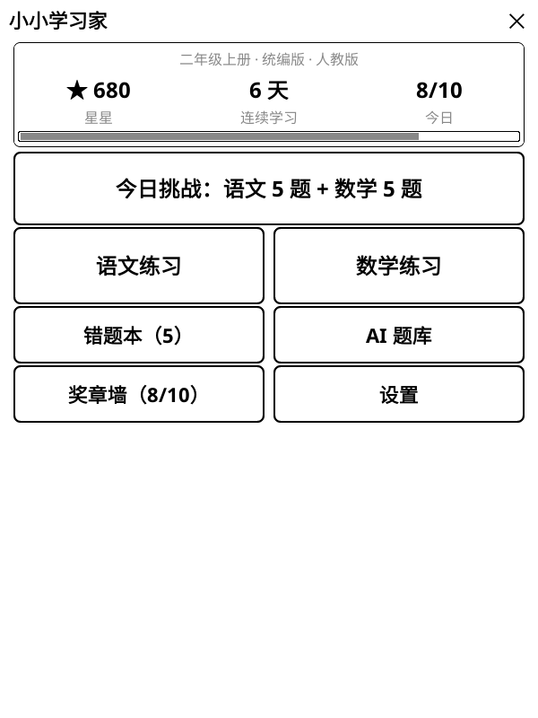</a><br>
      <sub>首页 · 每日总结与集卡册入口</sub>
    </td>
    <td align="center" width="220">
      <a href="docs/screenshots/daily-report.png">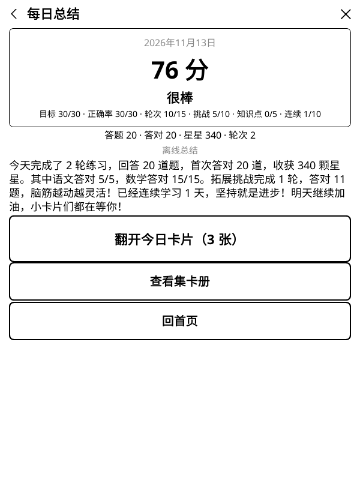</a><br>
      <sub>每日总结 · 评分与学习总结</sub>
    </td>
    <td align="center" width="220">
      <a href="docs/screenshots/daily-report-cards.png">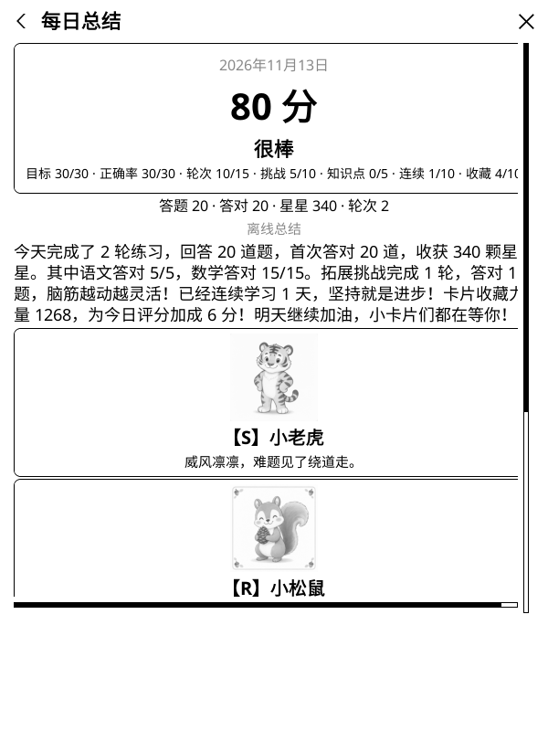</a><br>
      <sub>抽卡奖励 · 每次 3 张卡片</sub>
    </td>
  </tr>
  <tr>
    <td align="center" width="220">
      <a href="docs/screenshots/card-book.png"></a><br>
      <sub>集卡册 · SSS 为挑战专属级</sub>
    </td>
    <td align="center" width="220">
      <a href="docs/screenshots/badges.png">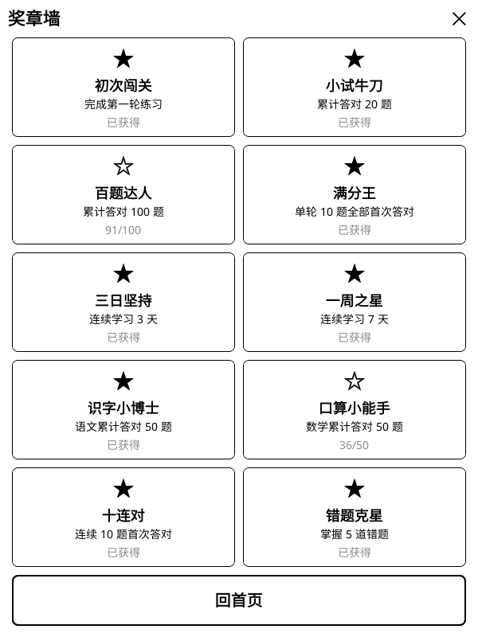</a><br>
      <sub>奖章墙 · 50 枚翻页</sub>
    </td>
    <td align="center" width="220">
      <a href="docs/screenshots/badges-challenge.png">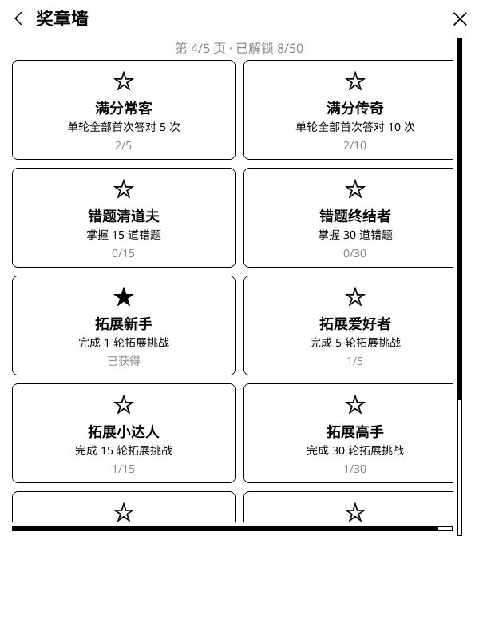</a><br>
      <sub>拓展挑战荣誉 · 轮次递进</sub>
    </td>
  </tr>
  <tr>
    <td align="center" colspan="3">
      <a href="docs/screenshots/card-detail.png">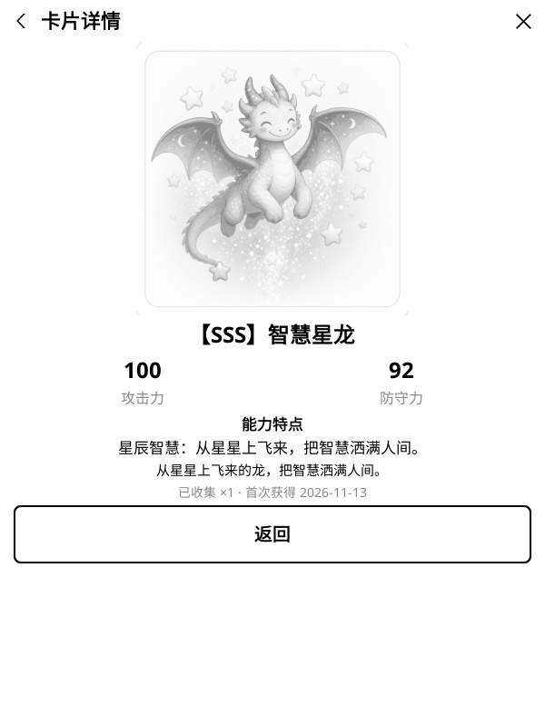</a><br>
      <sub>卡片详情 · 攻击力 / 防守力 / 能力特点</sub>
    </td>
  </tr>
  <tr>
    <td align="center" width="220">
      <a href="docs/screenshots/daily-quiz.png">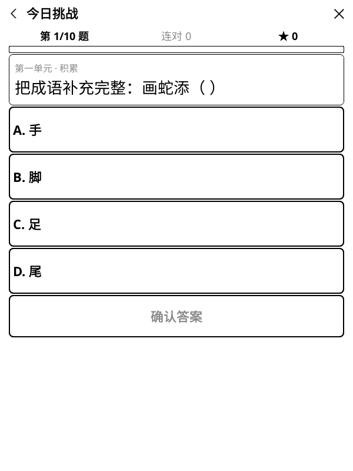</a><br>
      <sub>今日挑战 · 四选一答题</sub>
    </td>
    <td align="center" width="220">
      <a href="docs/screenshots/answer-feedback.png">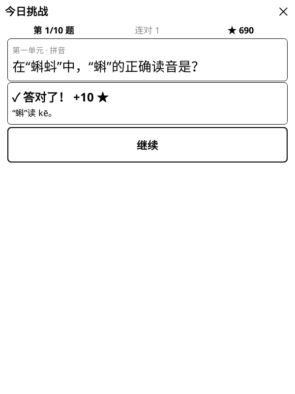</a><br>
      <sub>即时反馈 · 星星与解析</sub>
    </td>
    <td align="center" width="220">
      <a href="docs/screenshots/wrongbook.png">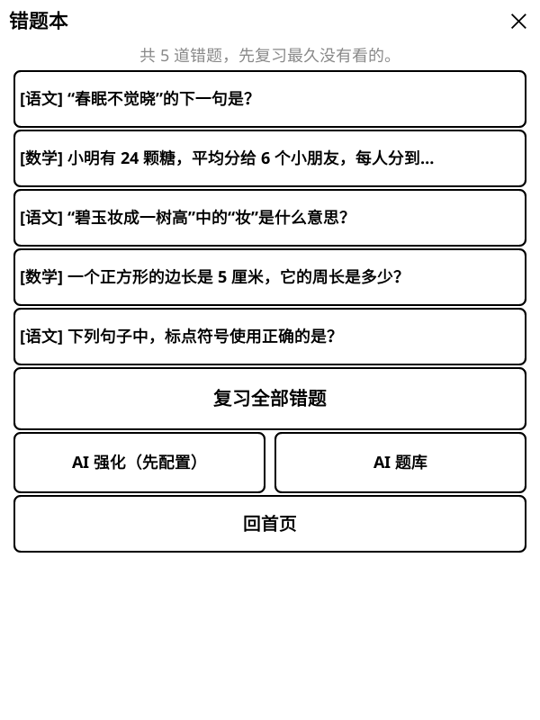</a><br>
      <sub>错题本 · 快照与复习入口</sub>
    </td>
  </tr>
  <tr>
    <td align="center" width="220">
      <a href="docs/screenshots/ai-preview.png">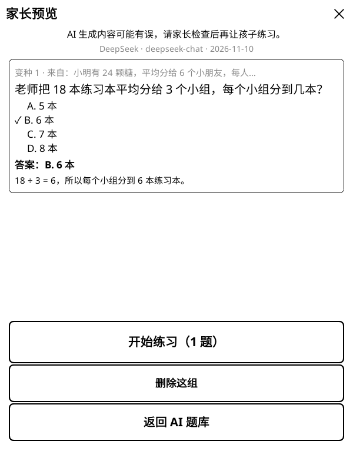</a><br>
      <sub>AI 变种 · 家长预览后练习</sub>
    </td>
    <td align="center" width="220">
      <a href="docs/screenshots/kp-select-math.png">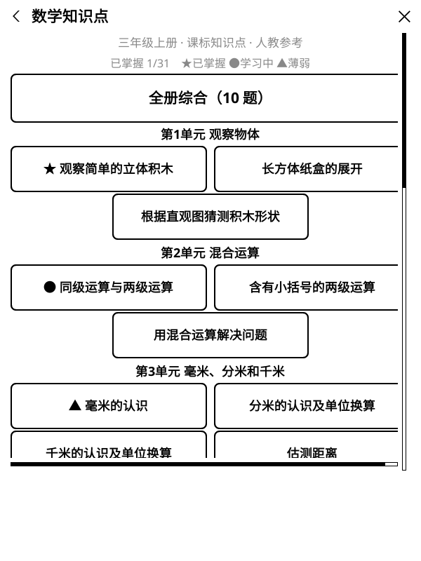</a><br>
      <sub>知识点列表 · 单元分组与掌握度</sub>
    </td>
    <td align="center" width="220">
      <a href="docs/screenshots/kp-learn.png">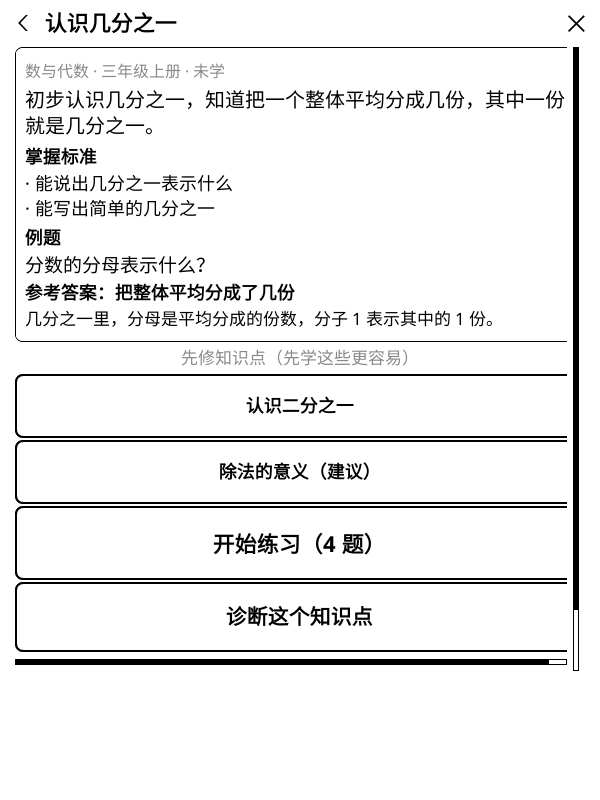</a><br>
      <sub>学习卡片 · 先学后练</sub>
    </td>
  </tr>
  <tr>
    <td align="center" width="220">
      <a href="docs/screenshots/kp-quiz-fraction.png">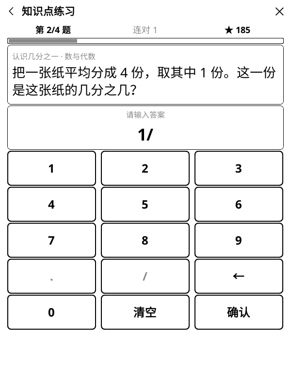</a><br>
      <sub>分数键盘 · 小数/分数输入</sub>
    </td>
    <td align="center" width="220">
      <a href="docs/screenshots/diagnose-result.png">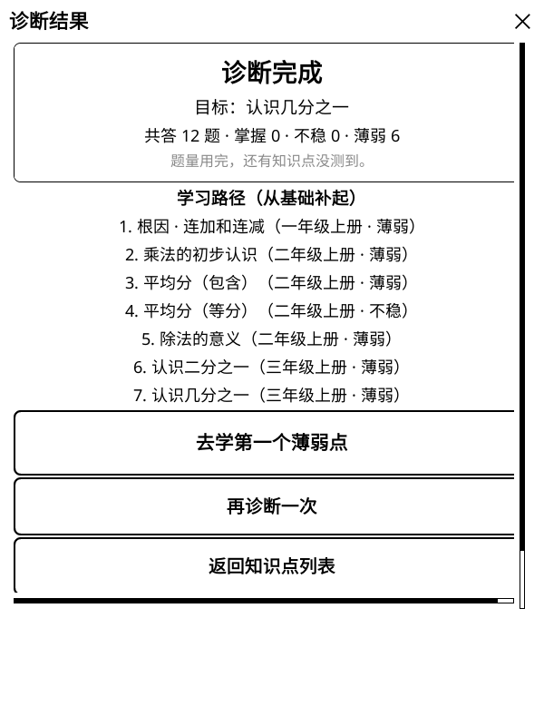</a><br>
      <sub>自适应诊断 · 回溯薄弱根因</sub>
    </td>
    <td align="center" width="220">
      <a href="docs/screenshots/kp-summary.png">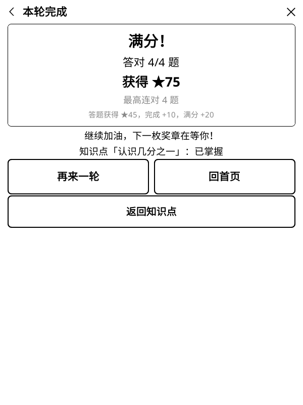</a><br>
      <sub>练习结算 · 掌握度回写</sub>
    </td>
  </tr>
</table>

---

| 项目 | 现状 |
| --- | --- |
| 适用设备 | Kindle（KOReader），其他 KOReader 设备理论可用 |
| 年级 | 小学 1–6 年级（上下册切换） |
| 省份 | 31 个省级行政区 + “其他/不指定”，用于推荐数学教材 |
| 语文 | 统编版，12 册 × 每单元 20 题，共 **1880 题**（含 96 篇原创短文） |
| 数学 | 人教版、北师大版、苏教版、青岛版、沪教版，**程序生成**，另有 17 类拓展题 |
| 交互 | 四选一 + 数字键盘，不需要中文输入法 |
| 数据 | 本地 `koreader/settings/kidlearn.lua`；可选 AI 配置 `kidlearn_ai_config.json`、AI 题库 `kidlearn_ai_bank.json` |
| 许可 | 代码跟随 KOReader 的 AGPL；题目为原创或公版内容 |

> 开发协作规范见同目录 [`AGENTS.md`](AGENTS.md)；构建 KOReader 本身见 [KOReader Building](https://github.com/koreader/koreader/blob/master/doc/Building.md)。

---

## 目录

- [预览](#预览)
- [功能](#功能)
- [安装](#安装)
- [在线更新](#在线更新可选联网)
- [使用](#使用)
- [出题与练习规则](#出题与练习规则)
- [知识点学习（课标知识图谱）](#知识点学习课标知识图谱)
- [积分、连续学习与奖章](#积分连续学习与奖章)
- [每日总结与抽卡](#每日总结与抽卡)
- [AI 错题变种](#ai-错题变种可选联网)
- [数据存储](#数据存储)
- [内容维护：语文题库](#内容维护语文题库)
- [数学出题器](#数学出题器)
- [开发与测试](#开发与测试)
- [代码结构](#代码结构)
- [已知限制与常见问题](#已知限制与常见问题)
- [参与贡献](#参与贡献)
- [许可](#许可)

---

## 功能

- **今日挑战**：语文 5 题 + 数学 5 题，约 5–10 分钟做完一轮。
- **语文练习**：按当前年级/教材的单元或综合练习；拼音、识字、量词、近反义词、句子、积累、阅读。
- **数学练习**：按当前年级/教材的单元或综合练习；口算、乘法口诀、除法、混合运算、单位、时间、搭配、推理等。
- **多年级 / 多教材**：设置里选择省份、年级、学期、语文教材、数学教材；省份会自动推荐常用数学版本，家长仍可手动覆盖。
- **拓展挑战**：每轮从 17 类拓展题中随机抽 10 类（同一轮不重复），覆盖数感、量感、推理意识、几何直观、数据意识、应用意识、创新意识；包含鸡兔同笼、排队、周期、植树、移多补少等经典题型。
- **知识点学习（课标图谱）**：同步 cn-math-taxonomy 小学数学 284 个知识点 / 1123 题、小学语文 494 个知识点 / 1976 题；按单元浏览、学习卡片先学后练、知识点练习与全册综合。
- **自适应诊断**：选一个知识点，答错沿先修边回溯找薄弱根因，生成学习路径；知识点掌握度持久保存。
- **即时反馈**：答对给星星，答错可再试一次，也可以直接看答案和解析。
- **激励系统**：星星积分、连对奖励、连续学习天数、50 枚奖章（翻页奖章墙）、错题本与错题复习。
- **每日总结与抽卡**：每累计首答 20 题获得 1 次抽卡机会，每次抽 3 张收藏卡（R/RR/S/SS，拓展挑战解锁 SSS），不限每日次数；首页与总结页实时显示抽卡进度与可抽次数。累计答题与拓展题越多，抽卡幸运越高，越容易抽到 SS、SSS；卡片带攻击力/防守力/能力特点与 AI 生成灰度卡面，收藏力量为评分加成（封顶 +10）；配置 AI 后由 AI 写总结与祝福语，未配置或失败时离线兜底；集卡册永久点亮已收集卡片，可点开卡片详情。
- **自适应难度**：每个学科独立记录水平，按最近 10 次首次作答的正确率自动升降。
- **AI 错题变种（可选联网）**：配置 OpenAI、DeepSeek、通义千问、Kimi、智谱、豆包、Gemini、Claude、硅基流动、OpenRouter、Ollama 或自定义 OpenAI 兼容服务，从错题生成同知识点变种题；单题 3 道、批量最多 10 道，生成后先给家长预览。
- **家长设置**：切换学期、每日目标（5/10/15/20 题）、答错是否可重试、AI 服务、重置进度。

墨水屏适配：单窗口内切换页面，不做动画，按钮和字号按屏幕缩放，避免频繁整屏刷新。

---

## 安装

> 🤖 **不会越狱 / 没装过 KOReader？想让 AI 一步步帮你装？**
> 见 [《用 AI 助手把小小学习家装进 Kindle（保姆级 · AI 可执行教程）》](docs/AI_INSTALL_GUIDE.md)：
> 把整份文档发给你的 AI（ChatGPT / Claude / Kimi / DeepSeek 等），它会带你完成越狱、安装 KOReader、安装本插件，
> 还能把你的 AI API 配置直接生成并推送到 Kindle，免去在墨水屏上手填 Key。

### Kindle

> 本仓库根目录就是插件本体。克隆或下载后，把整个仓库目录重命名为 `kidlearn.koplugin` 再复制；也可以直接用打包脚本生成安装包。

1. 用 USB 连接 Kindle。
2. 把 **整个** `kidlearn.koplugin` 文件夹复制到：

   ```text
   /Volumes/Kindle/koreader/plugins/kidlearn.koplugin/
   ```

   最终必须存在：

   ```text
   /Volumes/Kindle/koreader/plugins/kidlearn.koplugin/main.lua
   ```

3. 安全弹出 Kindle，重启 KOReader。
4. 主菜单 → **更多工具** → **小小学习家**。

也可以使用打包脚本生成的 `install/kidlearn/kidlearn.koplugin.zip`，解压后得到同名文件夹，放到上面的位置即可。

### 升级

覆盖 `kidlearn.koplugin` 文件夹不会影响学习记录：记录在 `koreader/settings/kidlearn.lua`；使用过 AI 出题时，变种题库在 `koreader/settings/kidlearn_ai_bank.json`。

不想每次用 USB 拷贝？插件内置了[在线更新](#在线更新可选联网)，可在「设置 → 检查更新」里直接从 GitHub Release 升级，学习记录同样不受影响。

### 绑定快捷键（可选）

插件注册了 Dispatcher 动作：

- 动作 ID：`kidlearn_open`
- 事件：`KidLearnOpen`

可以在 KOReader 的「手势管理 / 快捷键」里绑定它，一键打开。

---

## 在线更新（可选联网）

插件内置了从 GitHub Release 自更新的能力，省去每次用 USB 把文件夹拷到 Kindle 的麻烦。这是继 AI 出题之后第二个**可选联网**功能：**默认手动触发，不后台轮询、不收集任何数据**。

### 怎么用

1. 打开「设置」，可以看到「当前版本：vX.Y.Z」。
2. 点「检查更新」：插件请求 GitHub 最新 Release 并比对版本号。已是最新会提示「已是最新版本」；有新版本则弹确认框，点「升级」后开始下载 `kidlearn.koplugin.zip`。
3. 下载时会显示**进度条**（已下载 / 总大小和百分比）。下载**不设超时**：网络慢或暂时卡住只会停在当前进度，不会报错，什么时候继续由网络决定；不想等了随时点「取消下载」即可，取消不影响任何学习记录，也不会留下临时文件。下载完成后自动解压并替换插件程序。
4. 升级完成后提示重启 KOReader 生效（Lua 模块有缓存，必须重启）。点「重启」即可；选「稍后」则下次启动生效。

也可以在设置里打开「启动时自动检查更新」（**默认关闭**）。打开后，每次进入插件且设备已联网时静默检查一次，只有发现新版本才弹确认框；离线时不打扰、不会主动要求开 WiFi。

### 历史数据零影响（重要）

**升级只替换插件程序，绝不动你的学习记录。** 星星、连续打卡、每日统计、错题本、自适应等级、知识点掌握度、奖章和设置都在 `koreader/settings/kidlearn.lua`，AI 变种题库在 `koreader/settings/kidlearn_ai_bank.json`——这些都在插件目录**之外**。更新器的写入范围严格限定在插件目录和两个临时目录，从不读写 settings；升级失败会自动回滚到旧版本。无论成功、失败还是回滚，学习记录都逐字节不变（有专门的单元测试验证）。

### 发布约定（给维护者）

- 版本号唯一来源是 `_meta.lua` 的 `version`（如 `1.3.2`）。
- 在 GitHub 发 Release：tag 用 `vX.Y.Z`，附件名严格为 `kidlearn.koplugin.zip`（用 `tools/kidlearn/package_plugin.sh` 生成，包内顶层是 `kidlearn.koplugin/`）。
- 插件用 `https://api.github.com/repos/AvenGeeker/kidlearn/releases/latest` 检查，只认稳定版（不含 draft/prerelease）。
- 想验证更新流程：发一个比当前更高的 tag（如当前 1.3.2，发 v1.3.3）。

### 注意

- **开发版安装会被拒绝**：用 `test_plugin.sh` 链接进 KOReader 的符号链接安装属于开发版，更新器会提示手动更新，避免覆盖你的工作区。
- **网络**：直连 GitHub。国内访问可能较慢或不稳定：下载不设超时、带进度条，慢就慢慢等，随时可点「取消下载」；检查更新失败可重试。可在存档 `settings.update_api_url` 自定义检查接口地址（附件下载地址取自该接口返回，镜像需相应重写）。
- 首次使用前仓库需至少有一个已发布的 Release。

---

## 使用

首页显示总星星、连续学习天数、今日进度和奖章数，并提供：

| 入口 | 说明 |
| --- | --- |
| 今日挑战 | 语文 5 题 + 数学 5 题 |
| 语文练习 | 综合练习或具体单元 |
| 数学练习 | 综合练习、具体单元、拓展挑战 |
| 知识点学习 | 语文/数学知识点浏览、学习卡片、知识点练习、全册综合、自适应诊断 |
| 错题本 | 查看错题、重做单题、复习全部错题、AI 强化、AI 题库 |
| AI 题库 | 查看、预览、练习、删除已生成的 AI 变种题 |
| 奖章墙 | 50 枚奖章，每页 10 枚翻页查看，已获得 / 未解锁及进度 |
| 抽卡 / 今日总结 | 每累计 20 题得 1 次抽卡机会，每次抽 3 张卡，可重复；按钮显示「抽卡（X/20）」或「可抽 N 次」；已有总结且无机会时显示「今日总结 ✓」 |
| 集卡册 | 按等级查看已收集卡片（卡面插画），点已收集卡进入详情页（攻击力/防守力/能力特点）；未收集显示卡背与「？？？」 |
| 设置 | 省份、年级、学期、语文教材、数学教材、每日目标、重试开关、AI 出题、重置进度、关于 |

答题流程：选择答案（或数字键盘输入）→ 点「确认答案」→ 立即判题 → 查看解析 → 继续下一题。
答错时如果开启了重试，可以「再试一次」；也可以「看答案」，此时显示正确答案和解析。

---

## 出题与练习规则

原有练习模式一轮固定 10 题；知识点练习按知识点出题（1–4 题）。各入口组成：

| 模式 | 题量 | 组成 |
| --- | --- | --- |
| 今日挑战 | 10 | 语文 5 + 数学 5 交替；数学第 4 题应用题、第 5 题拓展题 |
| 语文练习 | 10 | 指定单元，或按当前年级的单元轮换（综合练习） |
| 数学练习 | 10 | 第 4、8 题拓展题，第 6 题应用题，其余按单元轮换 |
| 拓展挑战 | 10 | 从 17 类中随机抽 10 类，同一轮不重复（可限定单元） |
| 错题复习 | ≤10 | 按最久未复习优先，最多 10 题 |
| AI 强化 | ≤10 | 取最久未复习的 5 道错题，每题 AI 生成 2 道变种；每次重新生成 |
| 知识点练习 | 1–4 | 单个知识点的全部题目，按难度升序 |
| 全册综合 | 10 | 当前年级/册按单元轮换抽知识点题，难度随自适应等级 |
| 知识点诊断 | ≤12 | 目标知识点 + 先修回溯；连对 2 题判掌握，答错补基础确认题 |

### 难度

- 每道题难度为 1–3；语文题库固定标注，数学由生成器按难度出题。
- 每个“学科 + 年级”有独立的 `adaptive.level`（1–3），初始为 2；切换年级不会串难度。
- 每 10 次**首次作答**结算一次：正确率 ≥ 90% 升一级，≤ 50% 降一级。
- 按当前等级抽题的概率：

  | 等级 | 难度 1 | 难度 2 | 难度 3 |
  | --- | --- | --- | --- |
  | 1 | 70% | 30% | 0% |
  | 2 | 30% | 50% | 20% |
  | 3 | 10% | 40% | 50% |

### 去重

最近答过的 30 道题会记录在 `recent_ids`，抽题时优先避开；题库不够时才允许重复。

---

## 知识点学习（课标知识图谱）

从开源项目 [cn-math-taxonomy](https://github.com/xiaoyang111222/cn-math-taxonomy) 同步的小学知识图谱与题库（**CC BY-NC 4.0**：署名、非商业使用；数据文件头记录了来源 commit）：

| 学科 | 知识点 | 题目 | 先修边 |
| --- | --- | --- | --- |
| 数学（人教 1–6 年级） | 284 | 1123 | 459（397 hard / 62 soft） |
| 语文（统编 1–6 年级） | 494 | 1976 | 656（268 hard / 388 soft） |

首页「知识点学习」→ 选学科 → 按当前年级/学期浏览：

- **知识点列表**：按教材单元分组，显示掌握状态（★已掌握 ●学习中 ▲薄弱，无标记 = 未学）；顶部「全册综合（10 题）」按单元轮换抽题，难度随自适应等级。
- **学习卡片（先学后练）**：知识点描述、掌握标准、例题与参考答案；列出直接先修知识点（hard 在前），可点击跳转先学基础；「开始练习（N 题）」按难度升序练该点全部题目（1–4 题）。
- **自适应诊断**：选一个目标知识点，引擎先出提高题；连对 2 题判「掌握」（并推断其先修已掌握）；答错补一道基础确认题——确认对判「不稳」，确认错判「薄弱」并沿先修边回溯（hard 优先，深度 ≤3，总题量 ≤12）。结果页给出掌握/不稳/薄弱清单和「学习路径」（薄弱根因在前），可一键去学第一个薄弱点。
- **掌握度存档**：练习与诊断结果写入 `kidlearn.lua` 的 `knowledge` 字段。单点练习首答全对 → 已掌握、全错 → 薄弱、其余 → 学习中；全册综合里每个知识点至少 2 题才升级掌握。诊断是测评：不给星星、不进错题本、不影响自适应等级与连续天数。

细节约定：

- 知识点模式**不受教材版本设置限制**：数学标注「课标知识点 · 人教参考」，语文标注「课标知识点 · 统编参考」；年级/学期沿用设置页。
- 数学数值题支持整数、小数、分数答案：小数/分数题的数字键盘会增加「.」「/」键，分数判分接受等价小数（如 1/2 = 0.5）。
- 同步时排除了 13 道不适合墨水屏纯文本界面的数学题：5 道依赖 SVG 图形、7 道多答案、1 道负数答案；排除后每个知识点仍至少 1 题。
- 知识点练习的计分、错题本、奖章规则与普通练习完全一致；原有模式（今日挑战/单元练习/拓展挑战）不受影响。

### 同步与维护

```bash
# 从本地 cn-math-taxonomy 检出重新生成 data/knowledge/（默认 ~/GitHub/cn-math-taxonomy）
python3 tools/kidlearn/sync_taxonomy.py --source ~/GitHub/cn-math-taxonomy
# 校验生成物
python3 tools/kidlearn/validate_knowledge.py
# 检查生成物是否与源一致（提交前）
python3 tools/kidlearn/sync_taxonomy.py --check
```

`data/knowledge/` 全部是生成产物，**不要手改**；源仓库更新后重跑同步脚本覆盖。

---

## 积分、连续学习与奖章

### 星星

| 场景 | 星星 |
| --- | --- |
| 首次答对 | +10 |
| 第二次答对 | +5 |
| 连对 3 题（首次答对） | 额外 +5 |
| 连对 5 题 | 额外 +10 |
| 连对 10 题 | 额外 +20 |
| 完成一轮 | +10 |
| 单轮 10 题全部首次答对 | 额外 +20 |
| 当天第一轮 | 额外 +10 |
| 错题复习首次答对 | +5 |
| 错题复习第二次答对 | +2 |

错题复习不参与连对奖励，也没有「完成一轮 / 满分 / 当天首轮」奖励。

### 连续学习

- 当天首次作答累计达到 **5 题**，记为一个学习日（答错也算）。
- 连续的自然日累加；断一天从 1 重新开始。
- 历史最长连续天数会保留，用于奖章判定。

### 奖章（50 枚）

奖章墙每页 10 枚（2×5），用「上一页 / 下一页」翻页；首页按钮显示 `奖章墙（x/50）`。
原有 10 枚奖章的条件与解锁记录完全不变，新增 40 枚按十条线递进：

| 线 | 奖章与条件（目标递进） |
| --- | --- |
| 原有 10 枚 | 初次闯关（完成第一轮）、小试牛刀（答对 20）、百题达人（答对 100）、满分王（单轮全对）、三日坚持（连续 3 天）、一周之星（连续 7 天）、识字小博士（语文答对 50）、口算小能手（数学答对 50）、十连对（连对 10）、错题克星（掌握 5 道错题） |
| 星星 | 星光闪闪 500 → 星星收藏家 2000 → 星空大师 5000 → 传奇星主 10000 |
| 答对 | 答题小勇士 300 → 知识小达人 600 → 千题学者 1000 → 学霸之星 2000 |
| 轮次 | 勤学不倦 30 → 百轮勇士 100 |
| 连续学习 | 半月恒心 14 → 月度之星 30 → 双月坚持 60 → 百日传奇 100 |
| 单科 | 识字小硕士（语文 150）、语文小学者（语文 300）、口算小硕士（数学 150）、数学小学者（数学 300） |
| 连对 | 十五连对 15 → 二十连对 20 |
| 满分轮 | 满分常客 5 → 满分传奇 10 |
| 错题掌握 | 错题清道夫 15 → 错题终结者 30 |
| 拓展挑战轮次 | 拓展新手 1 → 拓展爱好者 5 → 拓展小达人 15 → 拓展高手 30 → 拓展大师 60 → 拓展传奇 100 |
| 拓展挑战答对 | 思维萌芽 10 → 思维小火花 50 → 思维小火焰 150 → 思维小太阳 300 |
| 知识点掌握 | 知识点小收藏 10 → 知识点小达人 30 → 知识点小博士 60 |
| 集卡 | 稀有卡新手（首张 S 及以上）、集卡小行家（15 种）、传说收藏家（首张 SSS） |

拓展挑战的两条线（轮次 + 答对）共 10 枚奖章，同时决定抽卡时 SSS 级的出现概率（见下节）。
挑战计数从 v1.3.2 起累积，不追溯旧版本的历史轮次。

### 错题本

- 首次答错时把整道题快照存入错题本（含题干、选项、答案、解析）。
- 错题最多保留 200 道，超出时淘汰最久未复习的。
- 对错题本里的题，首次作答答对累计 2 次即视为「掌握」，移出错题本（普通练习和错题复习都算）。
- 因为存的是快照，之后修改题库不会改变已存在的错题。
- 错题详情可点「AI 出 3 道变种」；错题本可点「AI 强化」批量生成。生成结果先进入「家长预览」，确认后再练。
- AI 变种答错会作为普通错题进入错题本；答对不推进原错题的掌握进度。
- 所有生成结果长期保存在独立 AI 题库，可按组删除或清空；清空 AI 题库不会删除错题本。

---

## 每日总结与抽卡

首页「抽卡 / 今日总结」入口。**抽卡按累计题量解锁：每累计首答 20 题获得 1 次抽卡机会，每次抽 3 张卡，不限每日次数**。首页按钮与总结页都会实时显示「抽卡进度 X/20 · 可抽 N 次」；机会不足时点击会提示还差几题。错题复习的首答不计入抽卡题量，避免靠重做旧题刷抽卡。已生成的今日总结可随时查看、不消耗机会；想再抽时点总结页的「再抽 3 张卡」，会生成新一手 3 张卡并刷新今日总结。

1. **评分（本地公式，0–100）**：目标完成 30 分（今日答题数/每日目标）+ 首答正确率 30 分 + 轮次 15 分（每轮 5，最多 3 轮）+ 拓展挑战 10 分（每轮 5，最多 2 轮）+ 知识点练习 5 分（每题 1，最多 5 题）+ 连续学习 10 分（按当前连续天数/7 折算）+ 收藏力量 10 分（已收集卡的攻击力+防守力合计每 200 点折 1 分，封顶 10 分）。≥90 超赞、75–89 很棒、60–74 不错、<60 继续加油。
2. **总结文案**：配置了 AI 时，把当天聚合统计（学科/玩法/挑战/知识点/连续天数）发给 AI，生成 80–200 字总结和每张卡片的祝福语；未配置或请求失败时使用离线模板总结，卡片照常抽取。AI 失败可点「重试」或「看离线版」，不会后台自动重试。
3. **抽卡（每次 3 张，可重复）**：分数决定各等级权重，每张卡独立随机：

| 今日评分 | R | RR | S | SS |
| --- | --- | --- | --- | --- |
| <40 | 70% | 22% | 7% | 1% |
| 40–69 | 55% | 28% | 14% | 3% |
| 70–89 | 40% | 30% | 22% | 8% |
| ≥90 | 28% | 30% | 28% | 14% |

   **累计幸运**：每累计答题 100 道 +1 点，每累计完成拓展题 25 道 +1 点，合计封顶 +20 点。幸运点全部加到 SS 权重上；解锁挑战奖章后，每 2 点幸运再给 SSS 增加 1 点权重。也就是说，坚持做题、多做拓展挑战，SS、SSS 会越来越常见。

   **SSS 为拓展挑战专属**：只有解锁了挑战奖章才会进入卡池，权重 = 已解锁挑战奖章数 × (1 + ⌊评分/50⌋) + ⌊幸运/2⌋（10 枚挑战奖章满配、评分 100、幸运 20 时权重 40，约占总权重的 25%）。S 及以上（含 SSS）每次抽卡合计最多 3 张。
4. **翻开卡片**：抽卡后点「翻开今日卡片」查看 3 张卡面与祝福语，每张卡可点进详情页；重复抽到的卡只累计数量。查看已存总结不会重抽，只有主动再抽才生成新手。

- 卡池固定 38 张：R×12、RR×10、S×8、SS×5、SSS×3（动物 + 学习主题，名称、描述、攻击力/防守力与能力特点内置在 `core/cards.lua`）。攻防按等级取 10–100（R 10–30、RR 30–50、S 50–70、SS 70–90、SSS 90–100），能力特点为一句展示文案，无单卡主动技能。卡面为 AI 生成灰度插画（`data/cards/`，生成产物，`build_card_art.py` 后处理与校验）。
- 「集卡册」按 SSS→R 分组展示全部卡片：已收集显示卡面缩略图、名称与数量，点整格进入详情页（大图、攻击力、防守力、能力特点、描述、收集数量与首次获得日期）；未收集显示卡背与「？？？」，不可点击。卡片收藏永久保存，重置进度才会清空。
- 收藏力量加成只影响每日评分，不影响抽卡概率与星星；属性按卡池派生（同描述），旧存档无需迁移，不在卡池的旧卡按 10/10 计。
- 抽卡机会来自累计首答（每 20 题 1 次，错题复习不计）；抽卡结果先写入存档，再请求 AI，断网或 AI 失败不丢卡。
- 提示词只包含聚合统计与知识点名称，不包含 API Key 或个人信息。

---

## AI 错题变种（可选联网）

AI 出题未配置时不可用；家长在「设置 → AI 出题」里配置 API Key 和模型后即可使用。调用时只发送当前选中的错题快照（题干、选项、答案、解析、年级/单元/难度），不会发送孩子姓名或设备信息。

支持多个服务配置并选择一个当前服务：

| 预设 | 协议 | 默认接口 |
| --- | --- | --- |
| OpenAI | OpenAI 兼容 | `https://api.openai.com/v1` |
| DeepSeek | OpenAI 兼容 | `https://api.deepseek.com/v1` |
| 通义千问 | OpenAI 兼容 | `https://dashscope.aliyuncs.com/compatible-mode/v1` |
| Kimi | OpenAI 兼容 | `https://api.moonshot.cn/v1` |
| 智谱 GLM | OpenAI 兼容 | `https://open.bigmodel.cn/api/paas/v4` |
| 豆包/火山方舟 | OpenAI 兼容 | `https://ark.cn-beijing.volces.com/api/v3` |
| Google Gemini | Gemini 原生 | `https://generativelanguage.googleapis.com/v1beta` |
| Anthropic Claude | Anthropic 原生 | `https://api.anthropic.com/v1` |
| 硅基流动 | OpenAI 兼容 | `https://api.siliconflow.cn/v1` |
| OpenRouter | OpenAI 兼容 | `https://openrouter.ai/api/v1` |
| Ollama（局域网） | OpenAI 兼容 | 家长填写，例如 `http://<电脑IP>:11434/v1` |
| 自定义 | OpenAI 兼容 | 家长填写 |

- 每个配置只需要选预设、填 API Key 和模型；自定义服务还需要填接口地址。
- 「测试连接」会发送一条极短请求，可能消耗少量 token。
- API Key 明文保存在 `koreader/settings/kidlearn.lua`，设置页只显示末 4 位。KOReader 没有系统钥匙串，请使用低额度 Key，并避免在共用设备上保存。
- 公网服务请使用 `https://`；自定义 `http://` 只建议在可信局域网（如 Ollama）使用。
- AI 生成内容不保证完全正确；预览页会显示答案和解析，请家长检查后再让孩子练习。
- 不实现 token/额度统计、套餐自动切换、流式输出、取消请求或生成题编辑；费用由服务商账户管理。
- 阅读题沿用原阅读材料，只改变提问角度和选项；数学和字词题会更换数字、词语或情境。
- 生成结果会做结构校验（题量、四个不重复选项、答案 1–4、解析、阅读材料），但无法自动验证所有学科答案，仍需家长预览。
- 批量模式取最久未复习的 5 道错题，每题 2 道，最多 10 道；每次批量都会新建一组。
- 生成时模型先思考再一次性返回，通常需要 10–120 秒（批量出题更久），期间请停留在提示页；等待超时会提示「请求超时，请稍后重试」，点「重试」即可，不会自动重试。

### 用配置文件免手填（推荐）

如果不想在 Kindle 上逐项输入 API Key 和模型，可以在电脑上准备：

```text
koreader/settings/kidlearn_ai_config.json
```

Kindle 用 USB 连接后通常就是：

```text
/Volumes/Kindle/koreader/settings/kidlearn_ai_config.json
```

最小配置示例（`preset`、`api_key`、`model` 必填；`base_url` 可省略，省略时用预设默认地址）：

```json
{
  "preset": "deepseek",
  "base_url": "https://api.deepseek.com/v1",
  "api_key": "sk-你的Key",
  "model": "deepseek-chat"
}
```

`preset` 可用值：`openai`、`deepseek`、`qwen`、`kimi`、`zhipu`、`doubao`、`gemini`、`claude`、`siliconflow`、`openrouter`、`ollama`、`custom`。使用第三方中转或自定义 OpenAI 兼容地址时，写 `"preset": "custom"` 并填写 `base_url`。

仓库里有一份模板：[`tools/kidlearn/kidlearn_ai_config.example.json`](tools/kidlearn/kidlearn_ai_config.example.json)。复制为 `kidlearn_ai_config.json`、改好三个值，再推到上面的路径即可。**不要把填好 Key 的文件提交到 Git。**

也可以用脚本生成并直接推送到 Kindle（Kindle 挂载点通常是 `/Volumes/Kindle`）：

```bash
python3 tools/kidlearn/make_ai_config.py \
  --preset deepseek \
  --api-key sk-你的Key \
  --model deepseek-chat \
  --mount /Volumes/Kindle
```

不加 `--mount` 时只生成当前目录下的 `kidlearn_ai_config.json`；自定义接口地址用 `--base-url`，自定义显示名用 `--name`，预设用 `--preset custom`。

配置规则：

- 放入文件后重启 KOReader，插件会读入文件并在「设置 → AI 出题」显示「当前 AI 配置来自 …」。
- 文件内容变化后重启会重新导入；导入会**替换**插件里现有的 AI 服务列表，请把要保留的服务都写进同一个文件。
- 导入成功后可继续在插件里临时修改；只要文件内容不再变化，重启不会把临时修改改回去。删除配置文件并重启后，导入记录会清除，之后以插件内设置为准。
- 文件是 JSON，不能写注释；API Key 和 `kidlearn.lua` 一样是明文，请给 Key 设置低额度，并避免放在共用设备或公开仓库。
- 多个服务可以写成数组，并指定当前服务：

```json
{
  "active_id": "aip-2",
  "profiles": [
    { "id": "aip-1", "preset": "deepseek", "api_key": "sk-aaa", "model": "deepseek-chat" },
    { "id": "aip-2", "preset": "qwen", "api_key": "sk-bbb", "model": "qwen-plus" }
  ]
}
```

## 数据存储

进度文件：

```text
koreader/settings/kidlearn.lua
```

可选 AI 配置（推到设置目录后自动导入）：

```text
koreader/settings/kidlearn_ai_config.json
```

可选 AI 题库（只有使用过 AI 出题才会生成）：

```text
koreader/settings/kidlearn_ai_bank.json
```

Kindle 上通常对应 `/mnt/us/koreader/settings/`。`kidlearn.lua` 是 KOReader `LuaSettings` 序列化的 Lua 表，主要字段：

| 字段 | 内容 |
| --- | --- |
| `schema_version` | 存档版本，当前为 5 |
| `total` | 总星星、答题数、正确数、轮数、满分轮数、最高连对、掌握错题数、拓展挑战轮数、拓展挑战答题数、拓展挑战答对数 |
| `by_subject` | 语文 / 数学各自的答题数与正确数 |
| `streak` | 当前连续天数、历史最长、最后学习日 |
| `daily` | 按日期统计的答题数、正确数、星星、轮数，以及学科细分、玩法轮数、拓展挑战统计、知识点练习记录、每日总结报告（`report`）；保留 90 天 |
| `wrong` | 错题快照，最多 200 条 |
| `badges` | 已解锁奖章及时间戳 |
| `adaptive` | 旧版各学科难度等级（用于迁移） |
| `adaptive_by_grade` | 各“学科 + 年级”的难度等级与最近 10 次统计 |
| `settings` | 省份、年级、学期、语文教材、数学教材、每日目标、重试开关、AI 服务配置 |
| `recent_ids` | 最近 30 道题 ID |
| `knowledge` | 各学科知识点掌握度（learning/mastered/weak）、首答计数、最近学习时间 |
| `cards` | 永久卡片收藏：每张卡的数量、首次/最近获得时间、名称与等级快照；不随 90 天清理删除。攻击力/防守力/能力特点按卡池派生，不占存档字段 |
| `draw` | 抽卡进度 `progress`（距下次抽卡已积累的首答数）、可用机会 `credits`、累计抽卡次数 `draws`；每 20 题首答 +1 机会，抽一次 -1 |

- **备份 / 换机**：复制 `kidlearn.lua`；如需保留 AI 变种题，再复制 `kidlearn_ai_bank.json`；用配置文件部署 AI 时，再带上 `kidlearn_ai_config.json`。
- **升级快照（v5）**：从旧版本升级后第一次写入前，插件会把原始存档完整复制为 `kidlearn.lua.pre-v5.bak`（一次性、永不覆盖、不自动删除）。迁移只新增字段，不改动既有星星、奖章（含解锁时间）、错题、知识点等任何数据。如需回滚：关闭 KOReader，把 `kidlearn.lua.pre-v5.bak` 复制回 `kidlearn.lua`。快照与存档一样含 AI 配置，请同等保密。KOReader 自身还会滚动保留 `kidlearn.lua.old` 作为日常写入备份。
- **重置进度**：设置 → 重置学习进度。只清空星星、打卡、奖章、错题、知识点掌握度、卡片收藏和挑战计数，保留省份、年级、学期、教材、每日目标、重试开关、AI 服务配置和 AI 题库。AI 题库可在题库页单独清空。
- 存档结构变化时必须在 `core/progress.lua` 的 `normalize()` 里做兼容处理，见 [`AGENTS.md`](AGENTS.md)。

---

## 内容维护：语文题库

语文题不是运行时随机生成的，而是由脚本从人工整理的数据生成 JSON，插件只读 JSON。

```text
tools/kidlearn/build_catalog.py       # 省份 / 年级 / 教材 / 单元目录
tools/kidlearn/build_bank.py          # 语文题目源数据 + 生成逻辑（唯一事实来源）
        │
        ├──> data/catalog.json                                  运行时目录
        └──> data/chinese/tongbian/
             ├── g1_upper.json ... g6_upper.json                    12 册题库
             └── g1_lower.json ... g6_lower.json
```

常用命令：

```bash
# 1. 修改教材目录后重新生成 catalog.json
python3 tools/kidlearn/build_catalog.py

# 2. 修改语文源数据后重新生成 12 册 JSON
python3 tools/kidlearn/build_bank.py

# 3. 校验题库（结构、选项、答案、拼音、每单元 20 题、难度分布）
python3 tools/kidlearn/validate_bank.py --all

# 4. 校验目录与数学知识点映射
python3 tools/kidlearn/validate_catalog.py

# 5. 导出家长抽查清单（每单元默认 5 题）
python3 tools/kidlearn/export_review.py
python3 tools/kidlearn/export_review.py --all          # 全部导出
python3 tools/kidlearn/export_review.py --per-unit 3   # 自定义抽样数量
```

> 生成拼音需要 `pypinyin`：`pip install -r tools/kidlearn/requirements.txt`。

`export_review.py` 输出到 `install/kidlearn/review/`（该目录被 `.gitignore` 忽略，不随仓库提交）。

### 每单元 20 题的构成

| 题型 | 数量 | 说明 |
| --- | --- | --- |
| 拼音 → 汉字 | 3 | 给拼音和组词提示，选汉字 |
| 汉字 → 拼音 | 3 | 给词语，选加点字读音 |
| 量词（低年级）/ 词语运用（中高年级）、近义词、反义词、句子、词语 | 5 | 各 1 题 |
| 综合词语与句子 | 3 | 近义词、句子、词语各 1 题 |
| 古诗与积累 | 4 | 补全诗句或名句 |
| 阅读理解 | 2 | 共用一段原创短文 |

每个单元固定 20 题，难度为 **8 道难度 1、8 道难度 2、4 道难度 3**。
多数年级每学期 8 个单元；六年级下册按教材实际为 6 个单元，因此该册为 120 题。

### 题目字段

```json
{
  "id": "zh2u-u1-001",
  "unit": "u1",
  "type": "pinyin_to_char",
  "skill": "pinyin",
  "difficulty": 1,
  "answer_mode": "choice",
  "stem": "“kē”对应的汉字是？提示：可以组成“蝌蚪”。",
  "options": ["蝌", "跳", "蚪", "池"],
  "answer": 1,
  "explain": "“蝌”读 kē，可以组词“蝌蚪”。"
}
```

| 字段 | 必填 | 说明 |
| --- | --- | --- |
| `id` | 是 | 全局唯一；格式为 `zh{年级}{u/l}-{单元}-{序号}`，如 `zh3u-u1-001` |
| `unit` | 是 | 必须是 `data/catalog.json` 中该年级/学期的单元 ID |
| `type` | 是 | `pinyin_to_char`、`char_to_pinyin`、`measure_word`、`synonym`、`antonym`、`sentence_choice`、`word_choice`、`accumulation`、`reading` |
| `skill` | 是 | 展示用技能标签，如 `pinyin`、`word`、`sentence`、`accumulation`、`reading` |
| `difficulty` | 是 | 1–3 |
| `answer_mode` | 是 | 语文目前都是 `choice` |
| `stem` | 是 | 题干 |
| `passage` | 阅读题必填 | 共用短文 |
| `options` | 是 | 恰好 4 个，互不重复、非空 |
| `answer` | 是 | 正确选项序号，1–4 |
| `explain` | 是 | 解析，至少 4 个字符 |

> ⚠️ **不要直接改生成出来的 JSON**：下次运行 `build_bank.py` 会被覆盖。要改题目，改 `tools/kidlearn/build_bank.py` 后重新生成。

### 校验脚本会检查什么

- `schema_version`、`subject`、`grade`、`semester` 正确；
- ID 跨 12 册全局唯一，单元存在，每单元恰好 20 题；
- 选项恰好 4 个且互不重复，答案在 1–4；
- 同一单元内题干不重复，解析不为空；
- 阅读题必须有 `passage`；
- 拼音题的声调正确（依赖 `pypinyin` 做深度校验）；
- 每单元难度必须为 8/8/4。

---

## 数学出题器

数学题全部在运行时由 `core/mathgen.lua` 生成，不占存储空间，也不会做完。

- 教材版本：**人教版、北师大版、苏教版、青岛版、沪教版**。
- 年级：1–6 年级，上下册；每个版本的单元名、顺序和知识点绑定在 `data/catalog.json`。
- 单元：每个单元绑定 1–3 个 `skills`，出题时在单元内轮换，避免一轮全是同一类题。
- 每个单元有对应的生成器或知识点题库，接收 `difficulty`（1–3）和可注入的 `rng`。
- 综合练习会轮换当前教材的单元；另外按规则穿插应用题和拓展题。
- **拓展题**：`challenge_generators` 注册了 17 个生成器，每个标注一项核心素养（数感、量感、推理意识、几何直观、数据意识、应用意识、创新意识）。

新增数学知识点需要：

1. 在 `tools/kidlearn/build_catalog.py` 给对应单元加上 `skills`；
2. 在 `core/mathgen.lua` 的 `skill_generators` 注册生成器；
3. 运行 `build_catalog.py`、`validate_catalog.py` 和插件测试。

---

## 开发与测试

### 前置条件

- 准备一份 KOReader 源码检出，并能构建模拟器（见 [KOReader Building](https://github.com/koreader/koreader/blob/master/doc/Building.md)）。默认使用 `~/GitHub/koreader`，其他位置用 `KOREADER_DIR=/path/to/koreader` 指定。
- 初始化 KOReader 子模块：

  ```bash
  cd "${KOREADER_DIR:-$HOME/GitHub/koreader}"
  git submodule update --init --recursive
  ./kodev build
  ```

- macOS 建议用 Homebrew 安装 `bash`、`gnu-getopt`、`coreutils`、`make`、`findutils`；脚本会查找 `/usr/local` 或 `/opt/homebrew` 下的 Homebrew `bash`。

### 运行模拟器

在仓库根目录执行：

```bash
tools/kidlearn/run_emulator.command
```

脚本会把本仓库链接到 `${KOREADER_DIR:-$HOME/GitHub/koreader}/plugins/kidlearn.koplugin`，设置 `KIDLEARN_AUTOSTART=1`，然后启动 KOReader。启动后约 1 秒会自动打开插件。

也可以先手动完成链接，再从 KOReader 目录运行：

```bash
cd "${KOREADER_DIR:-$HOME/GitHub/koreader}"
KIDLEARN_AUTOSTART=1 ./kodev run -b -W 600 -H 800 -D 167
```

### 单元测试

测试源码在本仓库 `spec/unit/kidlearn_*.lua`。`test_plugin.sh` 会临时把本仓库和测试链接进 KOReader，再通过 `front` 套件运行：

```bash
# 跑全部 11 个插件测试
tools/kidlearn/test_plugin.sh

# 只跑一个
tools/kidlearn/test_plugin.sh kidlearn_session

# 复用已有构建，跳过重新编译
KODEV_REUSE_BUILD=1 tools/kidlearn/test_plugin.sh kidlearn_session
```

| 测试 | 覆盖内容 |
| --- | --- |
| `kidlearn_bank` | 12 册题库加载、单元覆盖、阅读短文、旧接口兼容 |
| `kidlearn_catalog` | 省份/年级/教材目录、推荐教材、每个知识点的生成校验 |
| `kidlearn_mathgen` | 5 个版本 × 6 个年级 × 12 册单元的大量生成结果校验、拓展题 |
| `kidlearn_progress` | 积分、连对、连续天数、分年级自适应、错题掌握、存档兼容、v4→v5 迁移零丢失与升级快照 |
| `kidlearn_session` | 满分一轮、每日挑战、跨年级/教材、错题复习、重试与奖励 |
| `kidlearn_ui` | 首页 / 单元选择 / 省份/年级/教材选择 / 设置 / 奖章翻页 / 错题本 / AI 设置与预览 / 每日总结与重复抽卡 / 集卡册 / 卡片详情 / 更新下载进度对话框页面 |
| `kidlearn_ai` | 厂商协议、请求构建、响应解析、变种校验、AI 题库、AI 会话与存档兼容 |
| `kidlearn_knowledge` | 知识点分册/图谱加载、3–4 选项与分数判分、排除规则、缓存 |
| `kidlearn_diagnose` | 掌握/不稳/薄弱判定、先修回溯顺序、祖先推断、题量与深度上限、可复现性 |
| `kidlearn_cards` | 卡池完整性、卡片属性区间、收藏力量与评分加成、确认时间边界、评分公式、等级权重与 SSS 加成、抽卡上限、报告 JSON 校验、离线兜底、卡片收藏与挑战奖章 |
| `kidlearn_update` | 版本比较、Release 解析、路径净化、检查更新；增量下载引擎（进度、无超时等待、重定向、分块传输、取消）；升级成功/失败/回滚/取消/开发版拒绝下用户数据逐字节不变 |

### 打包

```bash
tools/kidlearn/package_plugin.sh
# 输出：install/kidlearn/kidlearn.koplugin.zip
```

`install/` 被 `.gitignore` 忽略，打包产物和导出的抽查清单都不会进入仓库。

发 GitHub Release 时：tag 用 `vX.Y.Z`（与 `_meta.lua` 的 `version` 对应），把 `kidlearn.koplugin.zip` 作为同名附件上传，插件的[在线更新](#在线更新可选联网)即可识别。

### 截图

```bash
tools/kidlearn/take_screenshots.sh
# 在 KOReader 模拟器运行时里走查全部页面，重新生成 docs/screenshots/*.png（600×800）
```

走查脚本 `tools/kidlearn/screenshot_walkthrough.lua` 会用一份演示存档跑通「今日挑战 → 拓展挑战 → 每日总结与翻卡 → 集卡册 → 卡片详情 → 奖章墙翻页 → 知识点学习 → 分数键盘练习 → 结算 → 诊断」并逐页截图（演示存档恰好积累 20 题，解锁一次抽卡）。

---

## 代码结构

```text
.
├── _meta.lua              # 插件名、描述与版本号（version 为更新比对唯一来源）
├── main.lua               # 入口：菜单注册、Dispatcher 动作、开发环境自动打开
├── core/
│   ├── catalog.lua        # 省份/年级/教材/单元目录读取
│   ├── bank.lua           # 语文题库：加载、校验、缓存、按单元/难度/最近题抽题
│   ├── knowledge.lua      # 课标知识点分册/先修图谱加载、分数/小数判分
│   ├── diagnose.lua       # 自适应诊断引擎（先修回溯、掌握/不稳/薄弱、学习路径）
│   ├── session.lua        # 会话构建（学科/今日/拓展/错题）、判题、连对、结算
│   ├── progress.lua       # 本地存档、每日统计、连续天数、分年级自适应、错题本
│   ├── badges.lua         # 50 枚奖章的定义与解锁判断
│   ├── cards.lua          # 38 张固定卡池、每日抽卡权重、收藏统计
│   ├── report.lua         # 每日评分公式、总结提示词与严格校验、离线兜底
│   ├── mathgen.lua        # 数学题与 17 类拓展题的程序生成器
│   ├── ai_config.lua      # AI 厂商预设、服务配置、Key 校验
│   ├── ai_http.lua        # LuaSocket/LuaSec + Turbo 的 HTTPS POST 传输
│   ├── ai_client.lua      # OpenAI / Anthropic / Gemini 请求与响应
│   ├── ai_variant.lua     # 变种提示词、严格 JSON 校验、题目标准化
│   ├── ai_bank.lua        # 独立 AI 变种题库 JSON 存储
│   ├── update.lua         # GitHub Release 在线自更新（可选联网，历史数据零影响）
│   └── update_http.lua    # 更新下载引擎：非阻塞分片下载，进度回调、无超时、可取消
├── ui/
│   ├── mainview.lua       # 单窗口状态机：首页/选单元/答题/反馈/总结/错题/AI/奖章/每日总结/集卡册/卡片详情/设置
│   ├── update_dialog.lua  # 更新下载进度对话框（进度条 + 取消按钮）
│   └── widgets.lua        # 按钮、卡片、标签、进度条等墨水屏小组件
├── docs/screenshots/      # README 预览截图（600×800）
├── data/
│   ├── catalog.json       # 省份/年级/教材/单元目录
│   ├── chinese/tongbian/  # 1-6 年级语文题库（生成产物）
│   ├── knowledge/         # 课标知识点分册题库 + 先修图谱（sync_taxonomy.py 生成）
│   └── cards/             # 卡面插画（AI 生成灰度 PNG，build_card_art.py 后处理，勿手改）
├── tools/kidlearn/        # 题库构建、校验、抽查导出、卡面后处理、打包、测试、模拟器启动
├── spec/unit/kidlearn_*.lua # 插件单元测试
├── AGENTS.md              # 开发协作规范
└── README.md
```

一次答题的调用链：

```text
main.lua → ui/mainview.lua（状态机）
              ├── core/catalog.lua  读取省份/年级/教材/单元
              ├── core/session.lua  构建题目、判题、连对
              ├── core/bank.lua     语文题读取与抽取
              ├── core/knowledge.lua 知识点题读取与判分
              ├── core/diagnose.lua 知识点诊断
              ├── core/mathgen.lua  数学题生成
              ├── core/progress.lua 记分、存档、错题、自适应
              ├── core/ai_*.lua     可选 AI 配置、请求、变种校验与题库
              ├── core/badges.lua   轮次结束时结算奖章
              └── core/report.lua + core/cards.lua  每日总结、评分与抽卡
```

---

## 已知限制与常见问题

**菜单里找不到插件？**
确认文件夹名以 `.koplugin` 结尾、`main.lua` 在文件夹根部，然后重启 KOReader。

**中文或拼音显示成方块？**
确认没有删除 `koreader/fonts`；插件依赖 KOReader 的 CJK 字体回退。

**进度没有保存？**
检查 `koreader/settings/` 是否可写。

**想重新开始？**
设置 → 重置学习进度。只清空星星、打卡、奖章、错题、知识点掌握度、卡片收藏和挑战计数；省份、年级、学期、教材、每日目标、重试开关、AI 服务配置和 AI 题库都会保留。

**为什么抽不到 SSS 卡？**
SSS 是拓展挑战专属：先完成拓展挑战解锁挑战奖章（轮次线 1/5/15/30/60/100、答对线 10/50/150/300），SSS 才会进入卡池；挑战奖章越多、当天评分越高概率越大。此外，累计答题每 100 道、累计拓展题每 25 道都会增加抽卡幸运，幸运会持续抬高 SS、SSS 的概率。

**升级后原来的星星和奖章还在吗？**
在。v5 迁移只新增字段，不改动任何既有数据；升级前还会自动生成一次性快照 `kidlearn.lua.pre-v5.bak`，可随时手动恢复。

**能多设备同步吗？**
不能。除家长主动使用的 AI 出题外，插件是单机离线的；没有账号、云同步或统计上报。换设备需要手动复制 `kidlearn.lua`，需要保留 AI 变种题时再复制 `kidlearn_ai_bank.json`；部署 AI 配置可复制 `kidlearn_ai_config.json`。

**AI 出题失败怎么办？**
先检查 Wi-Fi、API Key、模型名称和接口地址；用配置文件部署时，确认文件在 `koreader/settings/kidlearn_ai_config.json` 且是合法 JSON，改完文件后重启 KOReader。401 通常是 Key 无效，404 通常是模型或接口不存在，429 通常是请求太频繁或额度不足。「请求超时」多是模型思考太久或网络不稳，批量出题时可稍后重试。AI 返回格式不合格时不会保存，点「重试」即可。

**AI 生成的题一定正确吗？**
不保证。生成后会做结构校验（四个不重复选项、答案序号、解析、阅读材料），但学科答案仍需家长在「家长预览」里检查。AI 出题会消耗服务商 token，批量模式消耗更多。

**多教材的单元名一定和纸质课本完全一样吗？**
目录按公开教材目录整理，并支持家长在设置中选择版本；不同地区、不同年份的印次可能有少量差异。发现不一致时改 `tools/kidlearn/build_catalog.py` 后重新生成。

**为什么语文题不能完全自动扩充？**
语文题需要人工把关（答案唯一、拼音声调、解析难度），所以走「源数据 → 生成 → 校验 → 抽查」流程；数学题才是程序生成的。公开生字表整理出的题库建议家长用 `export_review.py` 抽查一次。

**模拟器脚本报找不到 `getopt` / `make`？**
脚本会同时查找 Apple Silicon（`/opt/homebrew`）和 Intel（`/usr/local`）Homebrew 路径。若仍失败，先安装依赖：`brew install bash gnu-getopt coreutils make findutils`。

**为什么不能直接跑 `./kodev test unit ...`？**
本仓库是独立插件仓库；用 `tools/kidlearn/test_plugin.sh` 会自动链接插件、测试到 KOReader，并使用正确的 `front` 套件。测试名是 `kidlearn_*`（不带 `_spec`）。

**改了 `data/*.json` 但界面没变化？**
`core/bank.lua` 有内存缓存，重启 KOReader；另外确认改的是 `build_bank.py`，不是只改了生成结果。

---

## 参与贡献

- Bug / 设备兼容问题：请附上 KOReader 版本、设备型号、复现步骤和相关日志。
- 修改代码或题库前，先读 [`AGENTS.md`](AGENTS.md)；题库 JSON 是生成产物，不要直接手改。
- 提交前至少运行插件单测：

  ```bash
  tools/kidlearn/test_plugin.sh
  ```

- 用户可见行为变化时同步更新本 README；新增内容应保持适龄、离线优先和墨水屏友好。

---

## 许可

插件代码跟随 KOReader 仓库的 **AGPL** 许可。
题目内容为原创或使用公版古诗/名句，不复制教材长课文。
`data/knowledge/` 下的知识图谱与题目改编自 [cn-math-taxonomy](https://github.com/xiaoyang111222/cn-math-taxonomy)，采用 **CC BY-NC 4.0**（署名、非商业使用）；商业使用需另行取得源项目授权。
