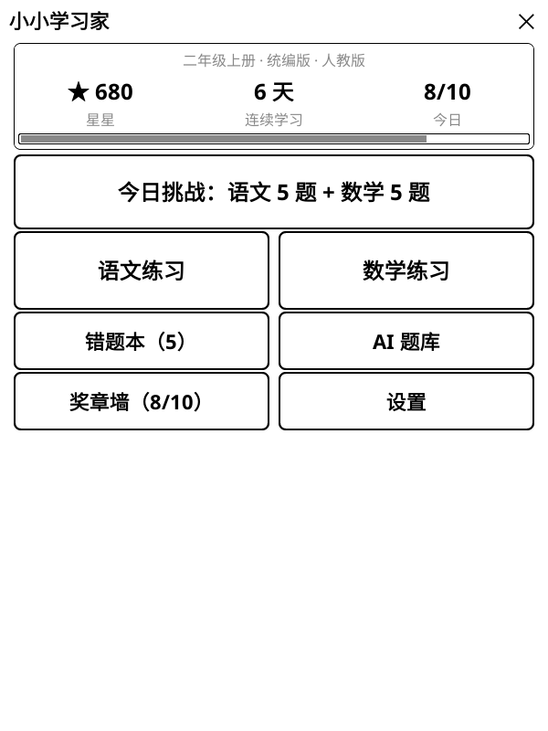
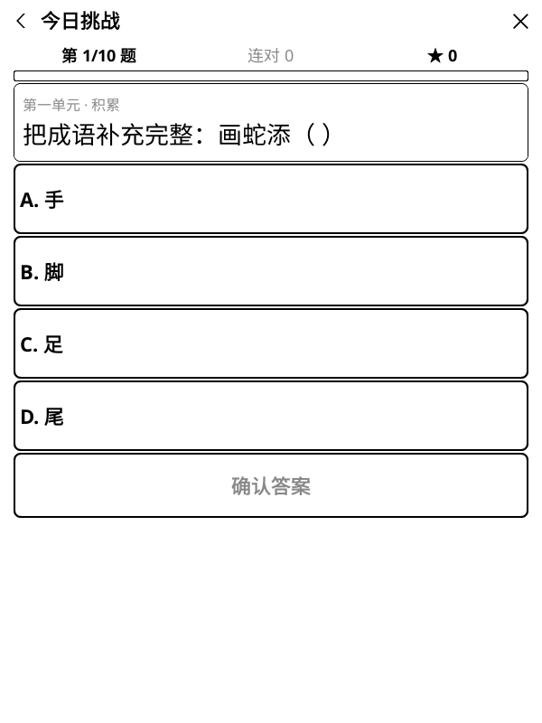
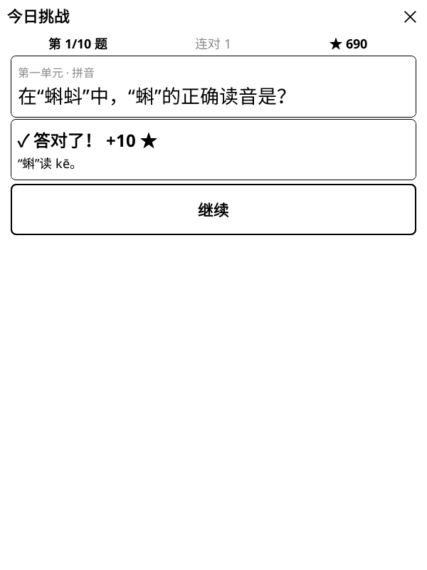

# 小小学习家 v1.2.0 · 首个公开版本

给小学 1–6 年级孩子用的 **KOReader 语文 / 数学练习插件**。
在 Kindle 墨水屏上打开就能练：一轮 10 题，约 5–10 分钟；默认离线、无广告、无账号，学习记录只保存在本机。

<p align="center">
  
  
  
</p>

## 这个版本包含什么

- **今日挑战**：语文 5 题 + 数学 5 题，每天一小轮。
- **1–6 年级、上下册**：按省份、年级、教材和单元选择练习范围。
- **语文 1880 题**：统编版 12 册，覆盖拼音、识字、量词、近反义词、句子、积累、阅读。
- **数学无限题**：人教版、北师大版、苏教版、青岛版、沪教版，运行时程序生成。
- **17 类拓展挑战**：数感、推理、几何、数据、应用与创新意识；每轮随机抽 10 类。
- **即时反馈**：答对得星星；答错可再试一次，也可以查看答案和解析。
- **成长激励**：星星积分、连对奖励、连续学习天数、10 枚奖章、错题本与错题复习。
- **自适应难度**：每个学科独立记录最近 10 次首次作答，自动升/降难度。
- **可选 AI 错题变种**：支持 OpenAI、DeepSeek、通义千问、Kimi、智谱、豆包、Gemini、Claude、硅基流动、OpenRouter、Ollama 等；生成后先进入家长预览，不直接推给孩子。

## 安装

1. 下载 Release 附件中的 `kidlearn.koplugin.zip`，或克隆本仓库。
2. 解压后确认目录名为 `kidlearn.koplugin`，放到：

   ```text
   /Volumes/Kindle/koreader/plugins/kidlearn.koplugin/
   ```

3. 确认存在：

   ```text
   /Volumes/Kindle/koreader/plugins/kidlearn.koplugin/main.lua
   ```

4. 安全弹出 Kindle，重启 KOReader。
5. 主菜单 → **更多工具** → **小小学习家**。

升级时直接覆盖 `kidlearn.koplugin` 目录即可，不会清空星星、连续学习、奖章或错题。

## 隐私与数据

- 默认离线；没有账号、云同步、广告或统计上报。
- 学习进度保存在 `koreader/settings/kidlearn.lua`。
- AI 出题为可选功能。只有家长主动触发时，所选错题快照才会发送到对应 AI 服务商；不会发送孩子姓名或设备信息。
- API Key 明文保存在设备本地设置中，界面只显示末 4 位。请使用低额度 Key，不要把填好的配置文件提交到 Git。

## 开发与验证

- 插件代码：Lua / LuaJIT（Lua 5.1 语义），单窗口状态机，面向墨水屏刷新优化。
- 仓库内包含题库生成、校验、抽查、打包、模拟器和测试工具。
- 本版本验证：
  - 7 组插件单测全部通过（题库、目录、数学、存档、会话、UI、AI）
  - 教材目录校验通过
  - 1880 道语文题校验通过
  - 题库完整重建结果与仓库内 JSON 一致
  - 安装包不包含开发工具、测试或 Git 文件

## 已知限制

- AI 生成内容不保证完全正确，仍需家长在「家长预览」中检查。
- 除可选 AI 外，插件为单机离线模式，不支持多设备自动同步。
- 教材目录按公开资料整理，不同地区或印次可能存在少量单元名差异。
- 在 KOReader 600×800 模拟器上验证；Kindle 等墨水屏设备理论可用。

## 相关链接

- 完整功能、积分规则、题库维护和开发说明：[README.md](https://github.com/AvenGeeker/kidlearn#readme)
- 问题反馈：[GitHub Issues](https://github.com/AvenGeeker/kidlearn/issues)
