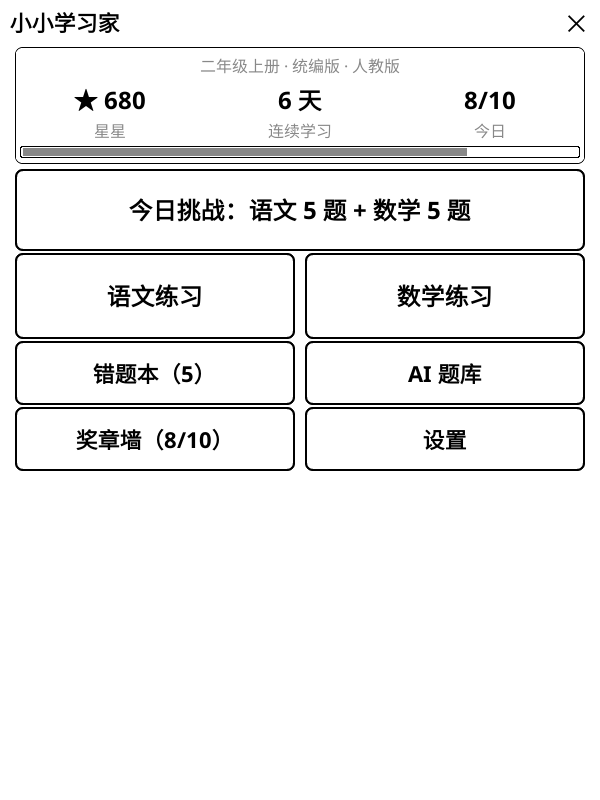
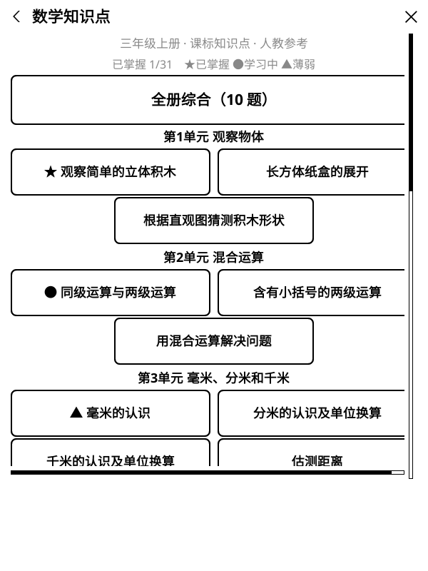
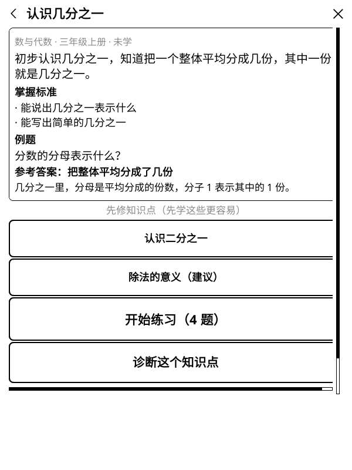
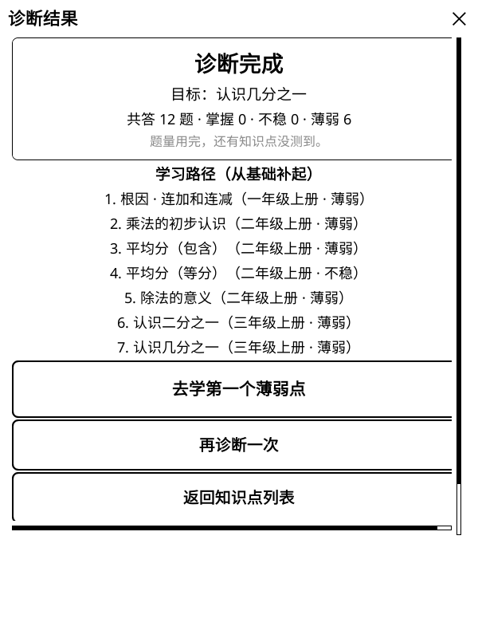

# 小小学习家 v1.3.0 · 课标知识图谱与自适应诊断

给小学 1–6 年级孩子用的 **KOReader 语文 / 数学练习插件**。
这个版本把最近很火的 [cn-math-taxonomy](https://github.com/xiaoyang111222/cn-math-taxonomy) 知识图谱搬进了 Kindle：**近 800 个课标知识点、3000+ 道题、1100+ 条先修关系**，全部离线可用。答错不再只是重做——插件会沿先修边一路回溯，找到孩子真正没学扎实的那个基础知识点。

<p align="center">
  
  
  
  
</p>

## 这个版本新增

- **知识点学习**：数学 284 个 + 语文 494 个课标知识点，按年级 / 学期 / 单元浏览，掌握状态一目了然（★已掌握 ●学习中 ▲薄弱）。知识点模式对齐课标，不受教材版本设置限制（数学标注「人教参考」，语文标注「统编参考」）。
- **学习卡片，先学后练**：每个知识点有通俗讲解、掌握标准和例题；列出直接先修知识点，可以点进去先补基础，再回来练习。
- **知识点练习**：单点练习 1–4 题按难度升序；「全册综合」10 题按单元轮换，难度随自适应等级。计分、错题本、奖章规则与普通练习一致。
- **自适应诊断**：选一个目标知识点，连对 2 题判「掌握」；答错补一道基础确认题——确认对判「不稳」，确认错判「薄弱」并沿先修边回溯（hard 优先，深度 ≤3，总题量 ≤12）。结果页给出掌握 / 不稳 / 薄弱清单和「学习路径」，一键去学第一个薄弱点。例：三年级分数题做错，可能一路追到一年级「连加和连减」。
- **知识点掌握度存档**：练习与诊断结果持久保存；存档结构 v3 → v4 自动迁移，老存档平滑升级。
- **分数 / 小数键盘**：数值题键盘新增「.」「/」键，分数判分接受等价小数（1/2 = 0.5）；错题本里的分数题也能正常复习。
- **标题栏返回键**：所有二级页面左上角新增「‹」返回键，一键回首页；更深层级逐级返回。答题中途返回会先确认，已答题目和星星保留。右上角「×」仍是退出插件。

## 保持不变

- 今日挑战、语文 / 数学单元练习、17 类拓展挑战、错题本与 AI 错题变种的规则完全不变。
- 默认离线、无广告、无账号、不收集数据；学习记录只保存在本机。

## 安装与升级

1. 下载 Release 附件中的 `kidlearn.koplugin.zip`，或克隆本仓库。
2. 解压后确认目录名为 `kidlearn.koplugin`，放到 KOReader 的 plugins 目录：

   ```text
   # 标准安装
   /Volumes/Kindle/koreader/plugins/kidlearn.koplugin/
   # KPM 安装（本仓库维护者的设备即此路径）
   /Volumes/Kindle/kmc/kpm/packages/koreader/koreader/plugins/kidlearn.koplugin/
   ```

3. 确认存在 `kidlearn.koplugin/main.lua`。
4. 安全弹出 Kindle，重启 KOReader。
5. 主菜单 → **更多工具** → **小小学习家**，首页即可看到「知识点学习」。

**升级**：直接覆盖 `kidlearn.koplugin` 目录即可，不会清空星星、连续学习、奖章、错题或 AI 题库；存档首次启动时自动迁移到 v4。

## 隐私与数据

- 默认离线；知识图谱与题库随插件内置，诊断和练习不联网。
- 学习进度保存在 `koreader/settings/kidlearn.lua`（新增 `knowledge` 掌握度字段）。
- AI 出题为可选功能，只有家长主动触发时所选错题快照才会发送到对应服务商；API Key 明文存于设备本地，界面只显示末 4 位，请使用低额度 Key。

## 开发与验证

- 插件代码：Lua / LuaJIT（Lua 5.1 语义），单窗口状态机，面向墨水屏刷新优化。
- 新增同步与校验工具：`sync_taxonomy.py`（确定性生成、`--check` 漂移检测）、`validate_knowledge.py`、`take_screenshots.sh`（模拟器走查截图）。
- 本版本验证：
  - 9 组插件单测、110 个用例全部通过（含真实数据跨册先修回溯集成测试）
  - 知识点数据校验通过：数学 284 点 / 1123 题 / 459 边，语文 494 点 / 1976 题 / 656 边
  - 同步结果与源仓库一致（`--check` 幂等）
  - KOReader 600×800 模拟器逐页走查 + 真实 Kindle 安装验证

## 已知限制

- 知识点题库每个点 1–4 题，反复练习会遇到重复；定位为课标知识点的学习入口，不是海量刷题。
- 同步时排除了 13 道不适合墨水屏纯文本界面的数学题（5 道依赖 SVG 图形、7 道多答案、1 道负数答案）。
- 诊断为测评定位：不给星星、不进错题本、不影响自适应等级与连续天数，只记录掌握度。
- 题库由 AI 生成并经自动核验与独立复核，**没有教师审核**，不保证绝对正确（源项目说明）。
- 数学章节映射为人教版参考；知识点本身对齐课标，其他教材版本可正常使用，单元名可能与孩子课本略有差异。

## 致谢与许可

- 知识图谱与题目改编自 [cn-math-taxonomy](https://github.com/xiaoyang111222/cn-math-taxonomy)，采用 **CC BY-NC 4.0**（署名、非商业使用），数据文件头记录了来源 commit；商业使用需另行取得源项目授权。
- 插件代码跟随 KOReader 的 **AGPL** 许可；语文题库为原创或公版内容。

## 相关链接

- 完整功能、积分规则、题库维护和开发说明：[README.md](https://github.com/AvenGeeker/kidlearn#readme)
- 问题反馈：[GitHub Issues](https://github.com/AvenGeeker/kidlearn/issues)
- 知识图谱源项目：[cn-math-taxonomy](https://github.com/xiaoyang111222/cn-math-taxonomy)
