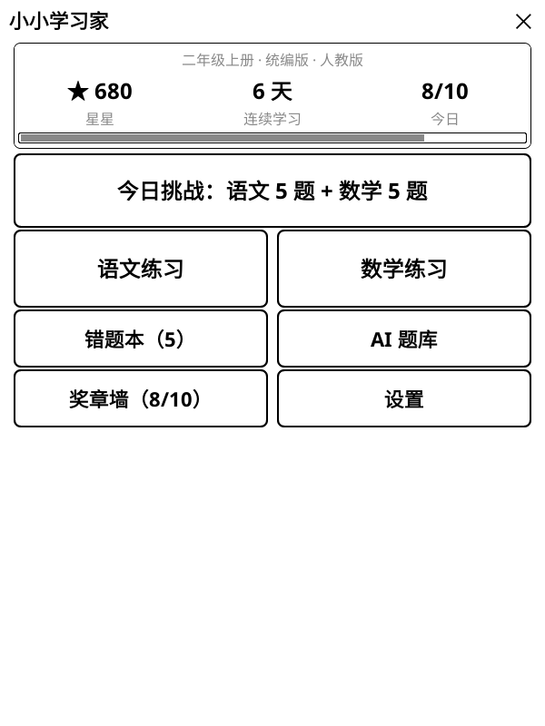
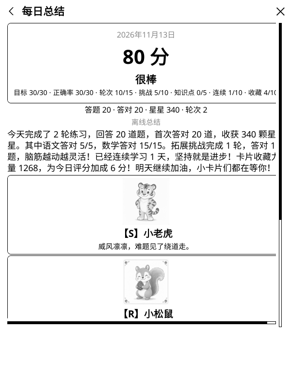
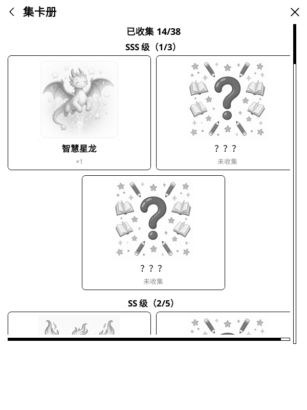
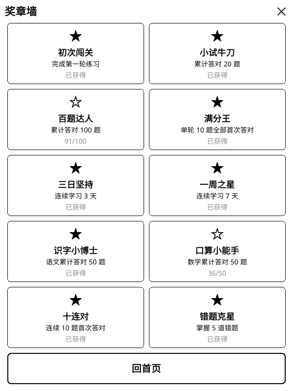

# 小小学习家 v1.3.2 · 每日总结抽卡、50 枚奖章与在线自更新

给小学 1–6 年级孩子用的 **KOReader 语文 / 数学练习插件**。
这个版本带来两条新主线：**每天一次的总结与抽卡**（本地评分 + 38 张卡池 + 永久集卡册），以及**插件内在线自更新**——以后升级不用再拔插 USB 拷文件夹。奖章墙从 10 枚扩展到 50 枚。存档升级到 v5，纯增量迁移，已有的星星、奖章、错题一条不丢。

<p align="center">
  
  
  
  
</p>

## 每日总结与抽卡（每天一次）

- **本地评分 0–100**：目标完成 30 分 + 首答正确率 30 分 + 练习轮次 15 分 + 拓展挑战 10 分 + 知识点练习 5 分 + 连续学习 10 分。≥90 超赞、75–89 很棒、60–74 不错、<60 继续加油。
- **每天抽 3 张卡**：固定 38 张卡池（R×12、RR×10、S×8、SS×5、SSS×3，动物 + 学习主题），今日评分越高，稀有等级权重越高。
- **SSS 为拓展挑战专属**：只有解锁了挑战奖章才会进入卡池，权重 = 已解锁挑战奖章数 × (1 + ⌊评分/50⌋)；多打拓展挑战，SSS 出现概率越高。
- **先落盘、再联网**：评分与抽卡先在本地完成并写入存档，之后才可选请求 AI 润色总结文案和卡片祝福语；断网或 AI 失败自动用离线模板，分数和卡片不受影响。当天再次进入直接看已存结果，不会重抽。
- **集卡册**：按 SSS→R 分组展示全部卡片，已收集点亮并显示数量，未收集显示「？？？」。卡片收藏**永久保存**（带名称/等级快照），重置进度才会清空。
- 当天至少首次作答 1 题才能领取总结。

## 奖章墙扩至 50 枚

- 原有 10 枚奖章的定义与解锁时间**完全不变**，新增 40 枚。
- 新增**拓展挑战双线计数**：轮次（拓展新手 → 拓展传奇 100 轮）与首答答对（思维萌芽 → 思维小太阳 300 题），共 10 枚；另有集卡奖章（首张 S 及以上、集齐 15 种、首张 SSS）。
- 每页 10 枚、共 5 页翻页浏览；首页按钮动态显示 `x/50`。
- 挑战计数从本版本起累积，不追溯旧版本的历史轮次。

## 在线自更新（可选联网）

- **设置 → 检查更新**：插件请求 GitHub 最新 Release 并比对版本号；发现新版本后确认下载 `kidlearn.koplugin.zip`，在设备上解压并原子替换插件程序，失败自动回滚，完成后提示重启 KOReader 生效。
- **启动时自动检查**：默认关闭。打开后每次进入插件且设备已联网时静默检查一次，只有发现新版本才弹确认框；离线不打扰、不主动要求开 WiFi、不后台轮询。
- **历史数据零影响**：星星、打卡、错题本、奖章、卡片、知识点掌握度与设置全部在插件目录之外的 settings 目录；更新器只写插件目录和两个临时目录，绝不触碰学习记录。单测逐字节验证了成功 / 失败 / 回滚 / 开发版拒绝四条路径下用户数据不变。
- 设置页新增「当前版本」显示；符号链接的开发版安装会拒绝自更新，避免覆盖工作区。
- **这是第一个带更新器的版本**：本次升级仍需 USB 覆盖安装；从下一个版本起，可直接在插件内检查并升级。

## 修复

- ** Kindle 批量生成 AI 变种题不再报 `wantread` 超时**：批量生成（5 道错题 × 2 个变种）常需要模型思考 20 秒以上，Kindle 上回退到阻塞式 LuaSec 后旧超时会在等待中途到期。阻塞传输超时提高到 120 秒块 / 180 秒总时长，修正 turbo 可用性检测与看门狗时序，超时提示改为友好的可重试文案。

## 存档 v5 与升级保护

- 纯增量迁移：新增每日学科/玩法/知识点细分、挑战计数、卡片收藏与每日报告字段，老存档平滑升级，不删除、不改名任何既有字段。
- 首次升级到 v5 时，自动把原始存档一次性备份为 `kidlearn.lua.pre-v5.bak`（已存在则永不覆盖）。
- 每日报告随每日统计保留 90 天；**卡片收藏与奖章永久保留**。

## 保持不变

- 今日挑战、语文 / 数学单元练习、17 类拓展挑战、知识点学习与自适应诊断、错题本与 AI 错题变种的规则完全不变。
- 默认离线、无广告、无账号、不收集数据；学习记录只保存在本机。

## 安装与升级

1. 下载 Release 附件中的 `kidlearn.koplugin.zip`，或克隆本仓库。
2. 解压后确认目录名为 `kidlearn.koplugin`，放到 KOReader 的 plugins 目录：

   ```text
   # 标准安装
   /Volumes/Kindle/koreader/plugins/kidlearn.koplugin/
   # KPM 安装（本仓库维护者的设备即此路径）
   /Volumes/Kindle/kmc/kpm/packages/koreader/koreader/plugins/kidlearn.koplugin/
   ```

3. 确认存在 `kidlearn.koplugin/main.lua`。
4. 安全弹出 Kindle，重启 KOReader。
5. 主菜单 → **更多工具** → **小小学习家**，首页即可看到「每日总结」与「集卡册」。

**升级**：直接覆盖 `kidlearn.koplugin` 目录即可，不会清空星星、连续学习、奖章、错题、卡片或 AI 题库；存档首次启动时自动迁移到 v5 并生成一次性备份。

## 隐私与数据

- 默认离线；仅有两个**可选联网**功能：AI 出题与检查更新，都由用户显式触发（自动检查默认关闭，且仅在已联网时静默运行）。
- 更新器只下载插件程序包，不发送任何学习数据、姓名或设备信息。
- 学习进度保存在 `koreader/settings/kidlearn.lua`（v5 新增挑战计数、卡片收藏、每日报告等字段）；AI 变种题库在 `koreader/settings/kidlearn_ai_bank.json`。
- AI 出题为可选功能，只有家长主动触发时所选错题快照才会发送到对应服务商；API Key 明文存于设备本地，界面只显示末 4 位，请使用低额度 Key。

## 开发与验证

- 插件代码：Lua / LuaJIT（Lua 5.1 语义），单窗口状态机，面向墨水屏刷新优化。
- 版本号唯一来源是 `_meta.lua` 的 `version`（1.3.2）；Release tag 为 `v1.3.2`，附件名严格为 `kidlearn.koplugin.zip`。
- 本版本验证：
  - 11 组插件单测、156 个用例全部通过（新增集卡与更新器两组；更新器组覆盖版本比较、Release 解析、路径净化，以及成功 / 失败 / 回滚 / 开发版拒绝下用户数据逐字节不变）
  - KOReader 600×800 模拟器验证 + 真实 Kindle 安装验证

## 已知限制

- SSS 卡需要先解锁拓展挑战奖章才会进入卡池；每天固定抽 3 张，同日不重抽。
- 更新器直连 GitHub，国内访问可能较慢或不稳定，失败可重试；可在存档 `settings.update_api_url` 自定义检查接口地址。
- 更新器要求仓库至少有一个已发布的 Release；本版本是首个内置更新器的版本，需先 USB 安装。
- AI 生成的总结与祝福语不保证完全贴切，离线模板始终可用作兜底。

## 相关链接

- 完整功能、积分规则、题库维护和开发说明：[README.md](https://github.com/AvenGeeker/kidlearn#readme)
- 问题反馈：[GitHub Issues](https://github.com/AvenGeeker/kidlearn/issues)
