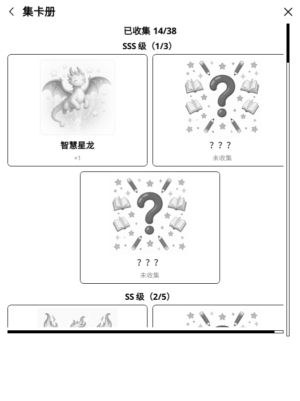
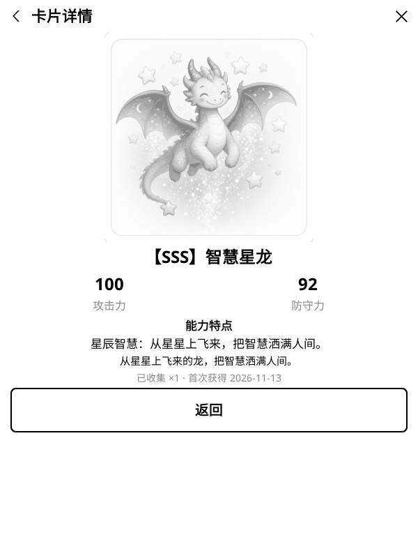
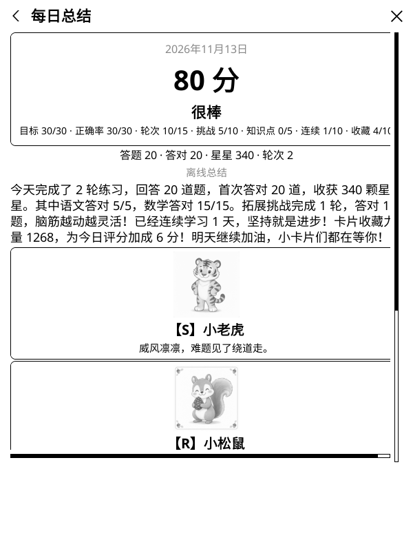

# 小小学习家 v1.4.0 · 卡面插画、卡片属性与今日总结二次确认

给小学 1–6 年级孩子用的 **KOReader 语文 / 数学练习插件**。
这个版本给集卡玩法补上了「看得见的卡面」和「摸得着的成长」：38 张卡片全部配上 AI 生成的灰度插画，已收集的卡可以点进详情页查看攻击力 / 防守力 / 能力特点；收藏越多，每日评分越高（封顶 +10）。同时，晚上 7 点前打开今日总结会先二次确认，提醒孩子「做题越多评分越高、完成挑战奖励更大」。存档结构不变，老版本平滑升级，星星、奖章、错题、卡片一条不丢。

  
  
  

## 卡面插画与卡片详情

- **38 张卡面 + 通用卡背**：AI 生成的可爱童趣灰度插画，墨水屏友好（480×480，单张 ≤80KB，总量约 2.7MB），内置离线可用，运行时不联网生图。
- **集卡册**：按 SSS→R 分组，已收集显示卡面缩略图、名称与数量，点整格进入详情页；未收集显示卡背与「？？？」，不可点击。
- **卡片详情页**：卡面大图、攻击力、防守力、能力特点、卡片描述、收集数量与首次获得日期；按入口返回集卡册或每日总结。
- 每日总结「翻开今日卡片」后的 3 张卡同样带缩略图，可点进详情。

## 卡片属性与收藏力量加成

- 每张卡带**攻击力 / 防守力**（按等级 R 10–30、RR 30–50、S 50–70、SS 70–90、SSS 90–100）与一句**能力特点**文案。
- **收藏力量**＝已收集卡的攻击力＋防守力总和（重复卡只算一种）；每 200 点力量为每日评分 **+1 分，封顶 +10**。总结页新增「收藏 x/10」分项。
- 加成**只影响每日评分**，不改变抽卡概率与星星规则；能力特点为展示文案，无单卡主动技能。
- 属性按卡池派生（同描述），**存档零改动**、无需迁移；不在卡池的旧卡按 10/10 计，老收藏立即生效。

## 今日总结二次确认

- **晚上 7 点（19:00，设备本地时间）前每次点击「今日总结」都会先弹确认**：提示「做题做得越多，评分越高；完成拓展挑战任务，抽卡奖励更大（有机会抽到 SSS 卡）」，可选「再练一会」或「现在打开」。
- 19:00 后不再提示；当天已生成过报告时，确认后只查看、不重抽。

## 升级与兼容

- 存档结构不变（仍为 v5），纯增量；老版本升级不丢星星、奖章、错题、知识点掌握度与卡片收藏。
- 卡面为插件内置资源，随安装包分发；重置进度才会清空卡片收藏。

## 验证

- 11/11 插件单元测试全绿（含卡片属性区间、收藏力量与加成封顶、确认时间边界、详情页双向返回）。
- 卡面校验通过：39 张齐全、灰度 480×480、单张 ≤80KB、总量 ≤3MB。
