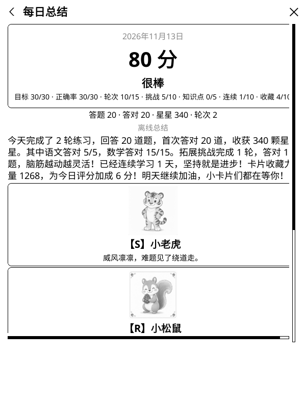
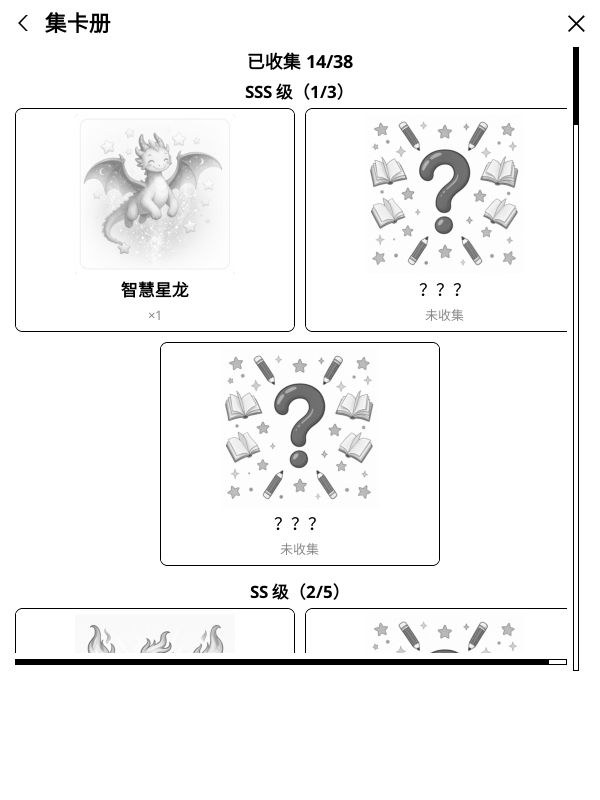
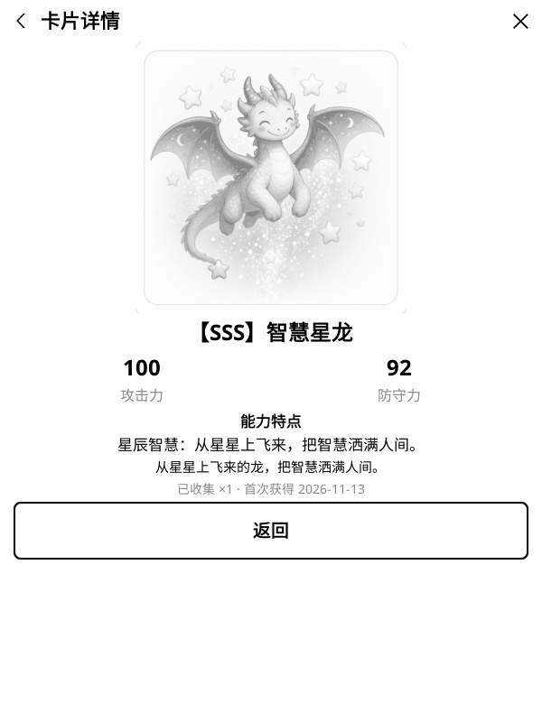

# 小小学习家 v1.5.0 · 做题攒抽卡、越练越幸运

给小学 1–6 年级孩子用的 **KOReader 语文 / 数学练习插件**。
这个版本把抽卡从「一天一次、还要等到晚上」改成了「做题攒机会、随时抽」：**每累计首答 20 题就获得 1 次抽卡机会，每次抽 3 张卡，不限每日次数**。同时加入「累计幸运」——坚持做题、多做拓展挑战，SS、SSS 卡会越来越常见。首页和总结页会实时显示抽卡进度，晚上 7 点的二次确认彻底取消。存档纯增量，老版本平滑升级，星星、奖章、错题、卡片一条不丢。

  
  
  

## 抽卡改为「做题攒机会」

- **每累计首答 20 题 = 1 次抽卡机会，每次抽 3 张卡**；机会可以攒着，当天能抽多次，不再限制「每日 3 张」。
- **实时进度**：首页按钮显示「抽卡（X/20）」或「抽卡（可抽 N 次）」；总结页显示「抽卡进度 X/20 · 可抽 N 次」。机会不足时点击会提示还差几题。
- **取消 19:00 二次确认**：任何时间都能抽，不再弹「还没到晚上 7 点」。
- **查看不消耗**：已生成的今日总结可随时回看，不扣机会；想再抽时点总结页的「再抽 3 张卡」，会生成新一手 3 张卡并刷新今日总结。
- **防刷**：只有正常练习的首答计入抽卡题量；错题复习的首答、第二次作答、自适应诊断都不计，避免靠重做旧题刷抽卡。

## 累计幸运：越练越容易出 SS / SSS

- **幸运值**＝每累计答题 100 道 +1 点、每累计完成拓展题 25 道 +1 点，合计封顶 **+20 点**。
- 幸运点全部加到 **SS** 权重上；解锁挑战奖章后，每 2 点幸运再给 **SSS** 增加 1 点权重。
- **SSS 仍是拓展挑战专属**：先完成拓展挑战解锁挑战奖章才会进入卡池；挑战奖章越多、当天评分越高、累计幸运越高，概率越大。
- 总结页新增「累计答题 X 道 · 拓展题 Y 道 · 抽卡幸运 +N」，让孩子看见坚持的回报。
- 每次抽卡内 S 及以上（含 SSS）合计最多 3 张；卡池、卡面、攻击力 / 防守力与收藏力量加成均不变。

## 升级与兼容

- 存档结构仍为 **v5**，纯增量：新增 `draw.progress`（距下次抽卡已积累的首答数）、`draw.credits`（可用机会）、`draw.draws`（累计抽卡次数），旧存档自动补默认值。
- 老版本升级不丢星星、连续学习、奖章、错题、知识点掌握度与卡片收藏；已收集的卡片永久保留。
- 「重置学习进度」会一并清空抽卡机会与累计进度（保留省份、年级、教材、每日目标、AI 配置等设置）。

## 验证

- 11/11 插件单元测试全绿（含：19 题不给机会、第 20 题解锁、查看总结不重抽、攒够再抽第二手、错题复习 / 二答不计、幸运值与 SS/SSS 权重提升）。
- 安装包顶层目录为 `kidlearn.koplugin/`，`_meta.lua` 版本为 `1.5.0`，符合在线更新器对附件名与目录结构的要求。
